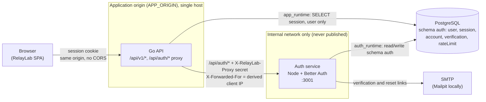
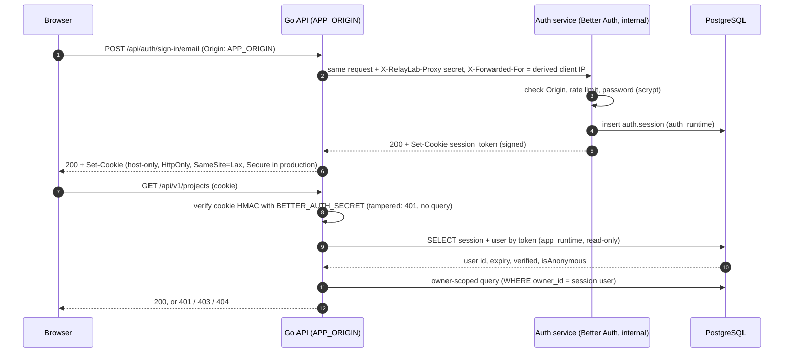

# Authentication and sessions

How RelayLab signs people in, how the Go API decides who is calling, and the
controls around it. This describes the implementation shipped by
Better Auth, pinned to an exact version, now **1.7.23** (moved from 1.7.18
after confirming the auth tables it creates are unchanged).

## Components and trust boundaries

| Boundary | Control |
|---|---|
| Browser → API | One origin for the SPA, `/api/v1`, and `/api/auth`. No CORS headers are ever sent. Cookies are host-only. |
| API → auth service | The auth service rejects any request without the `X-RelayLab-Proxy` shared secret (constant-time compare). It listens only on the internal network (in production: a sidecar on `localhost`). |
| Client IP | The Go API derives the client IP from `TRUSTED_PROXY_CIDRS` and replaces `X-Forwarded-For` with that single value. Client-supplied `Forwarded`/`X-Forwarded-*` headers are discarded. Better Auth rate-limits on this value. |
| API → database | `app_runtime` has `SELECT` on `auth."session"` and `auth."user"` only. It cannot write to any `auth` table or read `account` (password hashes), `verification` (tokens), or `rateLimit`. An integration test proves every write is denied. |
| Identity | Handlers get the acting user only from the validated session (`identity.FromContext`). User ids in bodies, query strings, or headers such as `X-User-Id` are ignored. |

## Sign-in and an authenticated request

**What Go never trusts.** The acting user comes only from the validated
session. User ids, owner ids, or project ownership claims in request bodies,
query strings, or headers (such as `X-User-Id`) are ignored; every query is
scoped to the session user, and a resource owned by someone else is
indistinguishable from one that does not exist (`404`). Client-supplied
forwarding headers are replaced, never trusted.

## How the Go API validates a session

The decision recorded in the design is **option A, shared-database validation**.
Alternatives considered:

| Option | Verdict |
|---|---|
| **A. Go verifies the cookie signature, then reads the session row** | **Chosen.** No extra network hop, no dependency on Node for authorization, and revocation is immediate. |
| B. Go calls `/api/auth/get-session` on every request | Rejected: adds latency to every call and every SSE re-check, and a Node outage would break the whole API. Kept as a documented fallback. |
| C. JWT plugin + JWKS | Rejected: revocation is delayed until the token expires. |
| D. Better Auth's signed cookie cache | Rejected: revocation is delayed by the cache lifetime. The cookie cache is **disabled**. |

For each `/api/v1` request (except `GET /api/v1/config`):

1. Read the session cookie: `relaylab.session_token` in development and test, `__Secure-relaylab.session_token` in production. Only the environment's name is accepted. Conflicting duplicate cookies are rejected.
2. URL-decode the value to `<token>.<signature>` and split on the last `.`.
3. Recompute `HMAC-SHA256(BETTER_AUTH_SECRET, token)` and compare it with the base64 (standard alphabet) signature in constant time. A malformed or tampered cookie is rejected **without querying the database**.
4. Look up the session with one read-only query (`backend/db/queries/identity.sql`) joining `auth."session"` to `auth."user"` by token.
5. Decide:

| Situation | Response |
|---|---|
| No cookie, malformed, tampered, unknown, or revoked (row deleted) | `401 unauthenticated` |
| `expiresAt` is now or in the past | `401 session_expired` |
| Verification required and the email is unverified | `403 email_not_verified` |
| Database unavailable | `500 internal_error` (details only in logs) |
| Otherwise | The request runs with that user's identity |

Go never refreshes, extends, or writes sessions.

## Session lifetime and refresh

- Sessions expire **7 days** after their last refresh. Better Auth refreshes a session at most once a day (`updateAge`) when the SPA's Better Auth client fetches `/api/auth/get-session`, which it does on page load and when the tab regains focus.
- Go enforces expiry on every request, but never extends it.
- Sign-out, sign-out everywhere, a password change (other sessions), a password reset (all sessions), and account deletion delete session rows. The next API request with a deleted session returns `401`.
- IP address and user agent are **not** stored on session rows: a database hook sets both to `null`.

## Cookies

| Attribute | Value |
|---|---|
| Name | `relaylab.session_token`; `__Secure-relaylab.session_token` in production |
| `HttpOnly` | Yes |
| `Secure` | Production only (`APP_ENV=production`, HTTPS origin) |
| `SameSite` | `Lax` |
| `Path` | `/` |
| `Domain` | Not set (host-only) |
| Value | URL-encoded `<token>.<base64 HMAC-SHA256 signature>` |

The cookie is also sent to `/h/*` webhook ingestion on the same host. Ingestion
never reads it, and the `Cookie` header is redacted on arrival.

## CSRF and cross-origin requests

- **`/api/v1`, unsafe methods** (`POST`, `PUT`, `PATCH`, `DELETE`):
  - `Origin` must equal `APP_ORIGIN` exactly. When the browser sends no `Origin`, `Sec-Fetch-Site` must be `same-origin`. Otherwise the response is `403 origin_rejected`.
  - Requests with a body must be `Content-Type: application/json`, otherwise `415 unsupported_media_type`. This also stops simple cross-site form posts in browsers that omit `Origin`.
- **`/api/auth/*`**: Better Auth checks `Origin` against its trusted origins, which are exactly `[APP_ORIGIN]`. RelayLab sets `disableOriginCheck: false` explicitly, because Better Auth otherwise switches the check off when it detects a test runner.
- **CORS**: none. The API emits no `Access-Control-*` headers, and the proxy strips any the auth service might send.
- Together with `SameSite=Lax`, this replaces CSRF tokens for a same-origin JSON API.

## Accounts, passwords, and email

- **Sign-up** is controlled by `AUTH_SIGNUP_ENABLED`: on by default in development, off in production. When it is off, the endpoint refuses and the UI hides the link and the route. Operators create accounts with `pnpm create-user -- --email … --name …`, which reads the password from stdin without echo.
- **Passwords** must be 12–128 characters and must not be on the common-password list (about 49,000 entries from zxcvbn-ts). Common passwords padded with digits or symbols, such as `Password123!`, are rejected too. Better Auth hashes them (scrypt) in `auth.account`.
- **Display names** must be 1–80 characters, with no control characters.
- **Email verification** is required by default (`AUTH_REQUIRE_EMAIL_VERIFICATION=true`). Links are single-use and expire after 24 hours. Unverified users cannot sign in.
- **Password reset** links are single-use and expire after 1 hour. A reset revokes every session.
- **No account enumeration**:
  - Password-reset requests get an identical response for known and unknown emails.
  - Sign-up with an existing email gets the same response as a new one; no account is changed and no email is sent.
  - Wrong passwords and unknown emails return the same sign-in error.
  - Exception: if verification is explicitly turned off, sign-up with an existing email returns "user already exists".
- **Rate limits**, per client IP, stored in the database so they hold across instances:

| Endpoint | Limit |
|---|---|
| `/api/auth/sign-in/email` | 10 per 5 minutes |
| `/api/auth/sign-up/email` | 5 per hour |
| `/api/auth/request-password-reset` | 3 per hour |
| `/api/auth/send-verification-email` | 3 per hour |

Throttled requests get `429` with `Retry-After`: Better Auth sends `X-Retry-After`, and the Go proxy copies it to `Retry-After`. Rate limiting cannot be disabled in production.

Rate-limit rows (`auth."rateLimit"`) are the only place an IP address is
stored. They are keyed `<ip>|<path>` and hold a counter and a timestamp.
The auth service, which owns the schema, deletes rows whose window has passed
every 10 minutes (`auth/src/retention.ts`).

## Demo users

When `DEMO_ENABLED` is on (the default outside production), "Try the demo"
calls Better Auth's anonymous sign-in (`POST /api/auth/sign-in/anonymous`).
It creates a user with `"isAnonymous" = true`, the name "Demo visitor", and
an address under the reserved `demo.relaylab.invalid` domain, and starts an
ordinary session cookie. A client IP may start `DEMO_STARTS_PER_HOUR` (10)
demos an hour; further attempts get `429`. With demos off, the endpoint does
not exist (`404`).

The Go API reads `isAnonymous` and the user's creation time with the
session. Demo users skip the email-verification check (they have no
address), get a seeded workspace and lower limits, and replay to their test
sink only. Their sessions are refused once `DEMO_TTL` (24 h) has passed since
the user was created, and the auth service deletes expired demo users every
10 minutes; their app data goes by cascade.

## Database ownership and migrations

| Schema | Owner | Migrations | Runtime role |
|---|---|---|---|
| `auth` | `auth_migrator` | `pnpm --filter @relaylab/auth migrate` (Better Auth `getMigrations`, plus grants) | `auth_runtime` (auth service) |
| `app` | `app_migrator` | goose (`pnpm --filter @relaylab/backend migrate`) | `app_runtime` (API, worker) |

`pnpm migrate` and the Compose `auth-migrate` step run the auth migrations
**first**, because app tables reference `auth."user"(id)`. The auth migrate
command is idempotent and, after Better Auth's own migrations, applies:

- a unique index on `auth."session"(token)` if it is missing (Better Auth 1.7.23 already creates it);
- `GRANT SELECT ON auth."session", auth."user" TO app_runtime`;
- `GRANT REFERENCES ON auth."user" TO app_migrator`.

It then checks that no schema change is still pending.

**Upgrading Better Auth**: change the exact version in `auth/package.json` and
`web/package.json` in a pull request, then run CI. The `auth-contract` job runs
the real auth service behind the real Go proxy and validator, and fails if the
cookie or table format changed.

## Secrets

| Secret | Used by | Notes |
|---|---|---|
| `BETTER_AUTH_SECRET` | Auth service (signs cookies) and Go API (verifies them) | At least 32 characters. The same value must reach both processes. **Rotating it signs every user out.** |
| `AUTH_PROXY_SHARED_SECRET` | Go API (sends it) and auth service (requires it) | At least 32 characters and different from `BETTER_AUTH_SECRET`. Rotate by deploying both processes together. |
| `SMTP_PASSWORD` | Auth service | Required in production (verification and reset emails). |
| `AUTH_DATABASE_URL`, `AUTH_MIGRATION_DATABASE_URL` | Auth service, migrate job | Credentials for `auth_runtime` and `auth_migrator`. |

Secrets are typed (`config.Secret` in Go, `Secret` in the auth service) so that
logging, JSON encoding, or printing the configuration shows `[redacted]`. The
migrate job needs no session or proxy secret. Generate secrets with
`openssl rand -base64 48`.

## Logging rules

- Neither service logs passwords, session tokens, cookie values, verification or reset tokens or links, secrets, SMTP credentials, or email addresses. Users are identified by id only.
- Auth service request lines record method, path, status, and duration. Query strings are dropped. Opaque path segments are replaced with `[REDACTED]`, because reset links carry the token in the path.
- Better Auth's own log messages are scrubbed of emails, URLs, and `token=`/`password=` values. Pino also redacts cookie, authorization, password, token, email, and URL fields.
- The Go access log records the route pattern (`/api/auth/*`), never the raw path. Proxy errors log only an error class (`connect`, `timeout`, `upstream`), never the upstream address.
- Tests capture logs across sign-up, verification, sign-in, reset, and sign-out, and fail if any credential appears.
