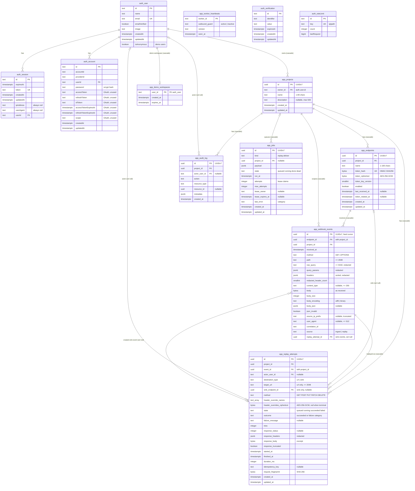

# Database schema (ERD)

This document describes the **actual** schema created by the goose migrations
in `backend/migrations/`, the Better Auth migrations run by
`pnpm --filter @relaylab/auth migrate`, and `deploy/sql/roles.sql`. It is
updated by every change that alters the schema.

## Current state

The `auth` schema holds Better Auth's tables (users, sessions, credentials).
The `app` schema holds `projects` (owned by `auth."user"` across schemas),
their webhook `endpoints`, the received `webhook_events`, the shared
`audit_log`, the `replay_attempts` of events, the background `jobs` queue,
`worker_heartbeats`, and `demo_workspaces`.

## Schemas and ownership

| Schema | Owner role | Managed by | Contents today |
|---|---|---|---|
| `app` | `app_migrator` | goose migrations in `backend/migrations/` | `projects`, `endpoints`, `webhook_events`, `audit_log`, `replay_attempts`, `jobs`, `worker_heartbeats`, `goose_db_version` (migration bookkeeping) |
| `auth` | `auth_migrator` | Better Auth 1.7.23 migrations (`auth/src/migrate.ts`) | `user`, `session`, `account`, `verification`, `rateLimit` |

Nothing is created in `public`; `CREATE` on `public` is revoked.

## Tables

### `app.goose_db_version`

goose's migration history. Created and owned by `app_migrator`; `app_runtime`
can read it so `/readyz` can compare applied and embedded versions.

| Column | Type | Notes |
|---|---|---|
| `id` | integer, identity | Primary key |
| `version_id` | bigint | Migration version |
| `is_applied` | boolean | Whether the version is applied |
| `tstamp` | timestamp without time zone | When the row was written (set by goose) |

### `app.projects`

User-owned projects: the isolation boundary for everything inside them.
Created by `backend/migrations/00002_projects.sql`.

| Column | Type | Notes |
|---|---|---|
| `id` | uuid | Primary key. UUIDv7 generated by the API (non-sequential to clients) |
| `owner_id` | text, not null | FK → `auth."user"(id)` **`ON DELETE CASCADE`** (cross-schema) |
| `name` | text, not null | `CHECK` 1–80 characters. Not unique per owner |
| `description` | text, nullable | `CHECK` at most 500 characters |
| `created_at` | timestamptz, not null | Default `now()` |
| `updated_at` | timestamptz, not null | Default `now()`; set on every update |

Index: `projects_owner_created_idx (owner_id, created_at DESC)`, used by the
owner-scoped list and the per-owner count. Every query filters by `owner_id`;
none loads a project by id alone.

The migration refuses to run if `auth."user"` does not exist: the auth
migrations must run first.

### `app.endpoints`

Webhook receiving endpoints. Created by `backend/migrations/00003_endpoints.sql`.
The receiving URL is `INGEST_BASE_URL + "/h/" + token`; the token itself is
never stored.

| Column | Type | Notes |
|---|---|---|
| `id` | uuid | Primary key, UUIDv7 |
| `project_id` | uuid, not null | FK → `app.projects(id)` **`ON DELETE CASCADE`** |
| `name` | text, not null | `CHECK` 1–100 characters |
| `token_hash` | bytea, not null | `HMAC-SHA256(ENDPOINT_TOKEN_HMAC_KEY, token)`, exactly 32 bytes, **unique**. Ingestion looks endpoints up by this hash |
| `token_ciphertext` | bytea, not null | `AES-256-GCM(ENDPOINT_TOKEN_ENC_KEY, token)`: 12-byte nonce + ciphertext + tag. The project and endpoint ids are additional authenticated data, so a ciphertext cannot be moved to another row |
| `token_key_version` | smallint, not null | Default 1; allows encryption-key rotation later |
| `enabled` | boolean, not null | Default true. Disabled endpoints keep their token and events |
| `last_received_at` | timestamptz, nullable | Set by ingestion |
| `token_rotated_at` | timestamptz, nullable | Last token rotation |
| `created_at`, `updated_at` | timestamptz, not null | Default `now()` |

Indexes and keys: `endpoints_token_hash_key` (unique `token_hash`),
`endpoints_id_project_key` (unique `(id, project_id)`, the target of the
`webhook_events` and `replay_attempts` composite foreign keys; added by `00004_webhook_events.sql`),
and `endpoints_project_created_idx (project_id, created_at DESC)` for the
owner-scoped, newest-first list. At most `LIMIT_ENDPOINTS_PER_PROJECT`
endpoints per project (default 25).

### `app.webhook_events`

One row per accepted webhook request, inserted before the sender is
acknowledged and never updated. Created by
`backend/migrations/00004_webhook_events.sql`. Sensitive header and query values
are replaced with `[REDACTED]` before the insert, so original credentials are
never stored; the body is stored exactly as received.

| Column | Type | Notes |
|---|---|---|
| `id` | uuid | Primary key, UUIDv7 (time-ordered; the event feed cursor) |
| `endpoint_id` | uuid, not null | With `project_id`: composite FK → `app.endpoints(id, project_id)` **`ON DELETE CASCADE`**, so an event always belongs to its endpoint's project |
| `project_id` | uuid, not null | FK → `app.projects(id)` **`ON DELETE CASCADE`**; denormalized for project-scoped queries |
| `received_at` | timestamptz, not null | Receive time, UTC |
| `method` | text, not null | `CHECK` one of `GET`, `POST`, `PUT`, `PATCH`, `DELETE`, `HEAD`, `OPTIONS` |
| `path` | text, not null | Subpath after the token (`''` for none), at most 2048 characters |
| `raw_query` | text, not null | Default `''`, at most 8192 characters; sensitive values replaced |
| `query_params` | jsonb, not null | Object `{name: [values]}`; sensitive values replaced |
| `headers` | jsonb, not null | Array `[[name, value], ...]` sorted by canonical name, repeated values in arrival order; sensitive values replaced |
| `redacted_header_count` | smallint, not null | Number of header values replaced at receipt (default 0) |
| `content_type` | text, nullable | Received value, truncated to 255 characters |
| `body` | bytea, not null | Raw body bytes, unmodified |
| `body_size` | integer, not null | `CHECK` equals `octet_length(body)` |
| `body_encoding` | text, not null | `utf8` or `binary` |
| `body_json` | jsonb, nullable | Parsed copy when the content type is JSON and the body parses (nesting up to 64 levels) |
| `json_invalid` | boolean, not null | JSON content type but the body did not parse; never true together with `body_json` |
| `source_ip_prefix` | inet, nullable | Client address truncated to IPv4 /24 or IPv6 /48 |
| `user_agent` | text, nullable | Truncated to 512 characters |
| `correlation_id` | text, not null | The request id (1–64 characters) |

Indexes: `webhook_events_project_id_idx (project_id, id DESC)` for the project
feed and cursor, `webhook_events_endpoint_id_idx (endpoint_id, id DESC)`,
`webhook_events_project_method_idx (project_id, method, id DESC)`,
`webhook_events_project_received_id_idx (project_id, received_at, id)` for the
retention cap and live-stream resume, `webhook_events_received_idx
(received_at)` for the retention age purge, and
`webhook_events_replay_attempt_idx (replay_attempt_id) WHERE replay_attempt_id
IS NOT NULL`, which keeps clearing sink references cheap when replays are
deleted. The retention indexes are added by `00006_retention.sql`, which
replaced the earlier `(project_id, received_at)` index.
`webhook_events_id_project_key` (unique `(id, project_id)`, added by
`00005_replay.sql`) is the target of the `replay_attempts` composite foreign key.

### `app.audit_log`

Who did what to which project resource. Shared by every module that audits
actions; created by `00003_endpoints.sql`. It never contains tokens, URLs,
secrets, or payloads.

| Column | Type | Notes |
|---|---|---|
| `id` | uuid | Primary key, UUIDv7 |
| `project_id` | uuid, not null | FK → `app.projects(id)` **`ON DELETE CASCADE`** |
| `actor_user_id` | text, nullable | FK → `auth."user"(id)` **`ON DELETE SET NULL`** |
| `action` | text, not null | For example `endpoint.created`, `endpoint.rotated` (1–64 characters) |
| `resource_type` | text, not null | For example `endpoint` |
| `resource_id` | uuid, nullable | The affected resource |
| `metadata` | jsonb, not null | A JSON object; for endpoints only the id and name |
| `created_at` | timestamptz, not null | Default `now()` |

Indexes: `audit_log_project_created_idx (project_id, created_at DESC, id DESC)`
and `audit_log_created_idx (created_at)` for the retention purge
(`00006_retention.sql`).

### `app.replay_attempts`

One row per replay a user starts; `tries` counts deliveries within it.
Created by `backend/migrations/00005_replay.sql`. The original event is never
changed by a replay.

| Column | Type | Notes |
|---|---|---|
| `id` | uuid | Primary key, UUIDv7; sent to destinations as `X-RelayLab-Replay-Id` |
| `project_id` | uuid, not null | FK → `app.projects(id)` **`ON DELETE CASCADE`** |
| `event_id` | uuid, not null | With `project_id`: composite FK → `app.webhook_events(id, project_id)` **`ON DELETE CASCADE`**, so the event is in the same project |
| `actor_user_id` | text, nullable | FK → `auth."user"(id)` **`ON DELETE SET NULL`** |
| `destination_type` | text, not null | `url` or `sink` |
| `target_url` | text, nullable | The URL as entered (1–2048 characters); set exactly for `url` replays |
| `sink_endpoint_id` | uuid, nullable | With `project_id`: composite FK → `app.endpoints(id, project_id)` **`ON DELETE SET NULL (sink_endpoint_id)`**: the sink is in the same project, and deleting it keeps the replay. Never set for `url` replays |
| `method` | text, not null | `GET`, `POST`, `PUT`, `PATCH`, or `DELETE` |
| `header_override_names` | text[], not null | Names of headers the user added (values are never stored in plaintext) |
| `header_overrides_ciphertext` | bytea, nullable | AES-256-GCM of the override values. **Null once the replay is terminal** (`CHECK`) |
| `state` | text, not null | `queued`, `running`, `succeeded`, `failed` |
| `outcome` | text, nullable | Set exactly when terminal (`CHECK`): `succeeded` or a failure category (`blocked_address`, `timeout`, `sink_disabled`, `worker_lost`, ...) |
| `failure_message` | text, nullable | Safe, fixed message per category (at most 300 characters); never addresses or raw errors |
| `tries` | integer, not null | Deliveries made (at most `REPLAY_MAX_TRIES`) |
| `response_status` | integer, nullable | Status of the final try |
| `response_headers` | jsonb, nullable | `[[name, value], ...]`, sensitive values `[REDACTED]` |
| `response_body` | bytea, nullable | Body excerpt, at most `REPLAY_RESPONSE_EXCERPT_BYTES` |
| `response_truncated` | boolean, not null | The body was longer than the excerpt |
| `started_at`, `finished_at` | timestamptz, nullable | First claim and terminal time |
| `duration_ms` | integer, nullable | Total delivery time |
| `idempotency_key` | text, nullable | Client `Idempotency-Key` (1–128 characters), honoured for 24 hours |
| `request_fingerprint` | bytea, nullable | SHA-256 of the canonical create request, compared on key reuse |
| `created_at`, `updated_at` | timestamptz, not null | Default `now()` |

Indexes: `replay_attempts_idempotency_idx` (unique `(project_id,
idempotency_key)` where a key is set), `replay_attempts_project_created_idx
(project_id, created_at DESC, id DESC)` for history,
`replay_attempts_event_created_idx (event_id, created_at DESC, id DESC)` for an
event's replays, `replay_attempts_active_idx (project_id, state)` for queued
and running replays (queue-depth limit), and `replay_attempts_sink_idx`.

### `app.jobs`

The background job queue (D5), used by the worker for `replay.deliver`.
Workers claim jobs with `FOR UPDATE SKIP LOCKED` and hold a lease; only the
lease holder may finish a job.

| Column | Type | Notes |
|---|---|---|
| `id` | uuid | Primary key, UUIDv7 |
| `kind` | text, not null | `replay.deliver` (1–64 characters) |
| `project_id` | uuid, nullable | FK → `app.projects(id)` **`ON DELETE CASCADE`**: deleting a project removes its queued and running jobs |
| `payload` | jsonb, not null | A JSON object; for replays `{"replay_id": ...}` |
| `state` | text, not null | `queued`, `running`, `done`, `dead` |
| `run_at` | timestamptz, not null | Not claimed before this time |
| `attempts` | integer, not null | Times claimed. A job whose lease expires `max_attempts` times becomes `dead` |
| `max_attempts` | integer, not null | `REPLAY_MAX_LEASE_LOSSES` for replays |
| `lease_owner`, `lease_expires_at` | text, timestamptz, nullable | Set exactly while `running` (`CHECK`) |
| `last_error` | text, nullable | A category such as `lease_expired`, at most 200 characters; never raw errors |
| `created_at`, `updated_at` | timestamptz, not null | Default `now()` |

Indexes: `jobs_queued_run_at_idx (run_at) WHERE state = 'queued'`,
`jobs_project_state_idx (project_id, state)` for per-project concurrency, and
`jobs_running_lease_idx (lease_expires_at) WHERE state = 'running'` for the
reaper, and `jobs_finished_updated_idx (updated_at) WHERE state IN ('done',
'dead')` for the retention purge (`00006_retention.sql`).

### `app.worker_heartbeats`

Each worker reports its outbound guard self-check here every 15 seconds. The
API offers URL replay only while some worker reported `active` within 60
seconds.

| Column | Type | Notes |
|---|---|---|
| `worker_id` | text | Primary key (1–128 characters) |
| `outbound_guard` | text, not null | `active` or `inactive` |
| `version` | text, not null | Worker build revision |
| `seen_at` | timestamptz, not null | Last heartbeat; rows older than a day are deleted by workers |

### `app.demo_workspaces`

One row per demo user (a Better Auth anonymous user) whose workspace has
been seeded. The API inserts it in the same transaction as the seeded
project, endpoints, and events, so a row means "seeded exactly once".
Created by `backend/migrations/00007_demo_workspaces.sql`.

| Column | Type | Notes |
|---|---|---|
| `user_id` | text | Primary key; FK → `auth."user"(id)` **`ON DELETE CASCADE`** |
| `created_at` | timestamptz, not null | Default `now()` |
| `expires_at` | timestamptz, not null | `created_at` + `DEMO_TTL` (24 h by default); `CHECK` later than `created_at` |

### `auth` tables (created by Better Auth)

Column names are camelCase and must be quoted in SQL (`"userId"`). The Go API
reads only `user` and `session`, through one query
(`backend/db/queries/identity.sql`); `backend/db/sqlc/10_auth_tables.sql`
declares those two tables for sqlc only.

| Table | Purpose | Key columns and constraints | Indexes |
|---|---|---|---|
| `auth."user"` | Accounts | `id text` PK (random string); `email text` UNIQUE, stored lowercase; `name text`; `"emailVerified" boolean`; `image text` (unused); `"isAnonymous" boolean` (added by the anonymous plugin: true only for demo users) | `user_pkey`, `user_email_key` |
| `auth."session"` | Active sessions | `id text` PK; `token text` UNIQUE (the cookie's token); `"expiresAt" timestamptz`; `"userId" text` FK → `user.id` `ON DELETE CASCADE`; `"ipAddress"`, `"userAgent"` always `NULL` (privacy hook) | `session_pkey`, `session_token_key`, `session_userId_idx` |
| `auth.account` | Credentials per provider. Email and password only: `providerId = 'credential'`, `password` is a scrypt hash | `"userId"` FK → `user.id` `ON DELETE CASCADE`; OAuth token columns unused | `account_pkey`, `account_userId_idx` |
| `auth.verification` | Single-use email-verification and password-reset tokens | `identifier`, `value`, `"expiresAt"` (verification: 24 h; reset: 1 h) | `verification_pkey`, `verification_identifier_idx` |
| `auth."rateLimit"` | Per-IP request counters for sign-in, sign-up, reset, and verification emails | `key text` UNIQUE (`<ip>|<path>`); `count integer`; `"lastRequest" bigint` (ms) | `rateLimit_pkey`, `rateLimit_key_key` |

Cardinality: a user has zero or more sessions, one credential account, and up
to `LIMIT_PROJECTS_PER_USER` projects (default 20). Deleting a user deletes
their sessions, accounts, and projects.

## Roles and privileges

| Role | Privileges |
|---|---|
| `app_migrator` | Owns `app`; DDL there; `USAGE` on `auth` and `REFERENCES` on `auth."user"` (for app foreign keys) |
| `app_runtime` | `USAGE` on `app`; `SELECT, INSERT, UPDATE, DELETE` on tables `app_migrator` creates (default privileges); `USAGE` on `auth` and **`SELECT` on `auth."session"` and `auth."user"` only** (granted by the auth migrate command; writes are denied, enforced by tests) |
| `auth_migrator` | Owns `auth`; DDL there |
| `auth_runtime` | `USAGE` on `auth`; data access to tables `auth_migrator` creates |

## Retention and deletion

**Permanent deletion contract (D18).** Deleting a project is a single
`DELETE FROM app.projects WHERE id = $1 AND owner_id = $2`; everything scoped
to the project goes with it through foreign-key cascades. Every later
project-scoped table must reference `app.projects(id) ON DELETE CASCADE`
through a `project_id` column and be registered in
`backend/internal/testutil/deletion/tables.go`. Tests enforce this: any `app`
table with an uncascaded or unregistered `project_id` fails the suite, and
deleting a project or its owner must leave no rows behind. There is no archive
or restore.

- **Projects**: kept until the owner deletes them (type-to-confirm in project settings) or deletes their account.
- **Endpoints**: kept until the owner deletes the endpoint (type-to-confirm) or its project. Deleting an endpoint removes its events and, through them, their replays; replays that used it as a sink are kept with `sink_endpoint_id` cleared. Rotating its token keeps everything.
- **Webhook events**: deleted by the worker's retention purge once older than `RETENTION_EVENT_TTL` (default 7 days) and beyond `RETENTION_MAX_EVENTS_PER_PROJECT` (default 10,000, oldest first), by the owner (one event, or all of an endpoint's), and with their endpoint or project (by cascade). Credential header and query values are never stored. See [Data retention and deletion](../security/data-retention.md).
- **Replay attempts**: deleted with their event, by every path above, or their project (by cascade). Sink events they created stay, with `replay_attempt_id` cleared (`ON DELETE SET NULL`). Header override values are erased (ciphertext set to null) as soon as the replay is terminal; response excerpts are kept with the replay.
- **Jobs**: deleted with their project, including queued and running ones; a worker whose rows disappear mid-run stops without writing. Finished (`done`, `dead`) rows are purged after `RETENTION_JOB_TTL` (default 7 days); queued and running jobs never expire by age. The purge also removes non-running jobs whose project or replay no longer exists (a safety net that normally finds nothing).
- **Worker heartbeats**: one row per worker; rows not updated for a day are deleted by running workers.
- **Audit log**: purged after `RETENTION_AUDIT_TTL` (default 90 days), and deleted with its project. If the actor's account is deleted, `actor_user_id` becomes `NULL` (in practice the actor's projects, and so these rows, are deleted too).

- **Demo users**: deleted by the auth service once older than `DEMO_TTL` (24 h by default); every app row they own (projects, endpoints, events, replays, jobs, audit entries, the `demo_workspaces` row) and their sessions go by cascade. Their sessions are refused as soon as the demo expires. Demo projects are capped at `DEMO_MAX_EVENTS` (200) stored events by the retention purge.
- **Accounts**: kept until the user deletes their account (Account settings → Delete account), which removes the `user` row and, by cascade, its sessions, credentials, and projects (with their endpoints, events, and audit entries).
- **Sessions**: deleted on sign-out, sign-out everywhere, password change (other sessions), password reset (all sessions), and account deletion. Expired rows are rejected immediately but remain in the table until Better Auth removes them.
- **Verification and reset tokens**: single use; they expire after 24 hours and 1 hour respectively.
- **Rate-limit counters**: the only place a full IP address is stored (webhook events keep only a truncated prefix). The auth service, which owns the schema, deletes rows whose last request is older than the longest rate-limit window (one hour) every 10 minutes.

## Generated schema listing

Every table, column, type, constraint, and index exactly as the migrations
create them. A test applies all migrations to an empty database and fails if
this listing differs, so it cannot drift from the schema.

<!-- schemadoc:schema:begin -->
Generated by `cmd/schemadoc` from a database with every migration applied (Better Auth, then goose). Do not edit by hand: run `pnpm docs:generate`.

#### `auth.account`

| Column | Type | Null | Default |
|---|---|---|---|
| `id` | `text` | no |  |
| `accountId` | `text` | no |  |
| `providerId` | `text` | no |  |
| `userId` | `text` | no |  |
| `accessToken` | `text` | yes |  |
| `refreshToken` | `text` | yes |  |
| `idToken` | `text` | yes |  |
| `accessTokenExpiresAt` | `timestamp with time zone` | yes |  |
| `refreshTokenExpiresAt` | `timestamp with time zone` | yes |  |
| `scope` | `text` | yes |  |
| `password` | `text` | yes |  |
| `createdAt` | `timestamp with time zone` | no | `CURRENT_TIMESTAMP` |
| `updatedAt` | `timestamp with time zone` | no |  |

Constraints:

- `account_pkey: PRIMARY KEY (id)`
- `account_userId_fkey: FOREIGN KEY ("userId") REFERENCES auth."user"(id) ON DELETE CASCADE`

Indexes:

- `CREATE UNIQUE INDEX account_pkey ON auth.account USING btree (id)`
- `CREATE INDEX "account_userId_idx" ON auth.account USING btree ("userId")`

#### `auth.rateLimit`

| Column | Type | Null | Default |
|---|---|---|---|
| `id` | `text` | no |  |
| `key` | `text` | no |  |
| `count` | `integer` | no |  |
| `lastRequest` | `bigint` | no |  |

Constraints:

- `rateLimit_key_key: UNIQUE (key)`
- `rateLimit_pkey: PRIMARY KEY (id)`

Indexes:

- `CREATE UNIQUE INDEX "rateLimit_key_key" ON auth."rateLimit" USING btree (key)`
- `CREATE UNIQUE INDEX "rateLimit_pkey" ON auth."rateLimit" USING btree (id)`

#### `auth.session`

| Column | Type | Null | Default |
|---|---|---|---|
| `id` | `text` | no |  |
| `expiresAt` | `timestamp with time zone` | no |  |
| `token` | `text` | no |  |
| `createdAt` | `timestamp with time zone` | no | `CURRENT_TIMESTAMP` |
| `updatedAt` | `timestamp with time zone` | no |  |
| `ipAddress` | `text` | yes |  |
| `userAgent` | `text` | yes |  |
| `userId` | `text` | no |  |

Constraints:

- `session_pkey: PRIMARY KEY (id)`
- `session_token_key: UNIQUE (token)`
- `session_userId_fkey: FOREIGN KEY ("userId") REFERENCES auth."user"(id) ON DELETE CASCADE`

Indexes:

- `CREATE UNIQUE INDEX session_pkey ON auth.session USING btree (id)`
- `CREATE UNIQUE INDEX session_token_key ON auth.session USING btree (token)`
- `CREATE INDEX "session_userId_idx" ON auth.session USING btree ("userId")`

#### `auth.user`

| Column | Type | Null | Default |
|---|---|---|---|
| `id` | `text` | no |  |
| `name` | `text` | no |  |
| `email` | `text` | no |  |
| `emailVerified` | `boolean` | no |  |
| `image` | `text` | yes |  |
| `createdAt` | `timestamp with time zone` | no | `CURRENT_TIMESTAMP` |
| `updatedAt` | `timestamp with time zone` | no | `CURRENT_TIMESTAMP` |
| `isAnonymous` | `boolean` | yes |  |

Constraints:

- `user_email_key: UNIQUE (email)`
- `user_pkey: PRIMARY KEY (id)`

Indexes:

- `CREATE UNIQUE INDEX user_email_key ON auth."user" USING btree (email)`
- `CREATE UNIQUE INDEX user_pkey ON auth."user" USING btree (id)`

#### `auth.verification`

| Column | Type | Null | Default |
|---|---|---|---|
| `id` | `text` | no |  |
| `identifier` | `text` | no |  |
| `value` | `text` | no |  |
| `expiresAt` | `timestamp with time zone` | no |  |
| `createdAt` | `timestamp with time zone` | no | `CURRENT_TIMESTAMP` |
| `updatedAt` | `timestamp with time zone` | no | `CURRENT_TIMESTAMP` |

Constraints:

- `verification_pkey: PRIMARY KEY (id)`

Indexes:

- `CREATE INDEX verification_identifier_idx ON auth.verification USING btree (identifier)`
- `CREATE UNIQUE INDEX verification_pkey ON auth.verification USING btree (id)`

#### `app.audit_log`

| Column | Type | Null | Default |
|---|---|---|---|
| `id` | `uuid` | no |  |
| `project_id` | `uuid` | no |  |
| `actor_user_id` | `text` | yes |  |
| `action` | `text` | no |  |
| `resource_type` | `text` | no |  |
| `resource_id` | `uuid` | yes |  |
| `metadata` | `jsonb` | no | `'{}'::jsonb` |
| `created_at` | `timestamp with time zone` | no | `now()` |

Constraints:

- `audit_log_action_check: CHECK (((char_length(action) >= 1) AND (char_length(action) <= 64)))`
- `audit_log_actor_user_id_fkey: FOREIGN KEY (actor_user_id) REFERENCES auth."user"(id) ON DELETE SET NULL`
- `audit_log_metadata_check: CHECK ((jsonb_typeof(metadata) = 'object'::text))`
- `audit_log_pkey: PRIMARY KEY (id)`
- `audit_log_project_id_fkey: FOREIGN KEY (project_id) REFERENCES app.projects(id) ON DELETE CASCADE`
- `audit_log_resource_type_check: CHECK (((char_length(resource_type) >= 1) AND (char_length(resource_type) <= 64)))`

Indexes:

- `CREATE INDEX audit_log_created_idx ON app.audit_log USING btree (created_at)`
- `CREATE UNIQUE INDEX audit_log_pkey ON app.audit_log USING btree (id)`
- `CREATE INDEX audit_log_project_created_idx ON app.audit_log USING btree (project_id, created_at DESC, id DESC)`

#### `app.demo_workspaces`

| Column | Type | Null | Default |
|---|---|---|---|
| `user_id` | `text` | no |  |
| `created_at` | `timestamp with time zone` | no | `now()` |
| `expires_at` | `timestamp with time zone` | no |  |

Constraints:

- `demo_workspaces_expiry: CHECK ((expires_at > created_at))`
- `demo_workspaces_pkey: PRIMARY KEY (user_id)`
- `demo_workspaces_user_id_fkey: FOREIGN KEY (user_id) REFERENCES auth."user"(id) ON DELETE CASCADE`

Indexes:

- `CREATE UNIQUE INDEX demo_workspaces_pkey ON app.demo_workspaces USING btree (user_id)`

#### `app.endpoints`

| Column | Type | Null | Default |
|---|---|---|---|
| `id` | `uuid` | no |  |
| `project_id` | `uuid` | no |  |
| `name` | `text` | no |  |
| `token_hash` | `bytea` | no |  |
| `token_ciphertext` | `bytea` | no |  |
| `token_key_version` | `smallint` | no | `1` |
| `enabled` | `boolean` | no | `true` |
| `last_received_at` | `timestamp with time zone` | yes |  |
| `token_rotated_at` | `timestamp with time zone` | yes |  |
| `created_at` | `timestamp with time zone` | no | `now()` |
| `updated_at` | `timestamp with time zone` | no | `now()` |

Constraints:

- `endpoints_id_project_key: UNIQUE (id, project_id)`
- `endpoints_name_check: CHECK (((char_length(name) >= 1) AND (char_length(name) <= 100)))`
- `endpoints_pkey: PRIMARY KEY (id)`
- `endpoints_project_id_fkey: FOREIGN KEY (project_id) REFERENCES app.projects(id) ON DELETE CASCADE`
- `endpoints_token_hash_check: CHECK ((octet_length(token_hash) = 32))`
- `endpoints_token_hash_key: UNIQUE (token_hash)`

Indexes:

- `CREATE UNIQUE INDEX endpoints_id_project_key ON app.endpoints USING btree (id, project_id)`
- `CREATE UNIQUE INDEX endpoints_pkey ON app.endpoints USING btree (id)`
- `CREATE INDEX endpoints_project_created_idx ON app.endpoints USING btree (project_id, created_at DESC)`
- `CREATE UNIQUE INDEX endpoints_token_hash_key ON app.endpoints USING btree (token_hash)`

#### `app.goose_db_version`

| Column | Type | Null | Default |
|---|---|---|---|
| `id` | `integer` | no |  |
| `version_id` | `bigint` | no |  |
| `is_applied` | `boolean` | no |  |
| `tstamp` | `timestamp without time zone` | no | `now()` |

Constraints:

- `goose_db_version_pkey: PRIMARY KEY (id)`

Indexes:

- `CREATE UNIQUE INDEX goose_db_version_pkey ON app.goose_db_version USING btree (id)`

#### `app.jobs`

| Column | Type | Null | Default |
|---|---|---|---|
| `id` | `uuid` | no |  |
| `kind` | `text` | no |  |
| `project_id` | `uuid` | yes |  |
| `payload` | `jsonb` | no | `'{}'::jsonb` |
| `state` | `text` | no | `'queued'::text` |
| `run_at` | `timestamp with time zone` | no | `now()` |
| `attempts` | `integer` | no | `0` |
| `max_attempts` | `integer` | no |  |
| `lease_owner` | `text` | yes |  |
| `lease_expires_at` | `timestamp with time zone` | yes |  |
| `last_error` | `text` | yes |  |
| `created_at` | `timestamp with time zone` | no | `now()` |
| `updated_at` | `timestamp with time zone` | no | `now()` |

Constraints:

- `jobs_attempts_check: CHECK ((attempts >= 0))`
- `jobs_kind_check: CHECK (((char_length(kind) >= 1) AND (char_length(kind) <= 64)))`
- `jobs_last_error_check: CHECK ((char_length(last_error) <= 200))`
- `jobs_lease_consistent: CHECK (((state = 'running'::text) = ((lease_owner IS NOT NULL) AND (lease_expires_at IS NOT NULL))))`
- `jobs_lease_owner_check: CHECK (((char_length(lease_owner) >= 1) AND (char_length(lease_owner) <= 128)))`
- `jobs_max_attempts_check: CHECK ((max_attempts > 0))`
- `jobs_payload_check: CHECK ((jsonb_typeof(payload) = 'object'::text))`
- `jobs_pkey: PRIMARY KEY (id)`
- `jobs_project_id_fkey: FOREIGN KEY (project_id) REFERENCES app.projects(id) ON DELETE CASCADE`
- `jobs_state_check: CHECK ((state = ANY (ARRAY['queued'::text, 'running'::text, 'done'::text, 'dead'::text])))`

Indexes:

- `CREATE INDEX jobs_finished_updated_idx ON app.jobs USING btree (updated_at) WHERE (state = ANY (ARRAY['done'::text, 'dead'::text]))`
- `CREATE UNIQUE INDEX jobs_pkey ON app.jobs USING btree (id)`
- `CREATE INDEX jobs_project_state_idx ON app.jobs USING btree (project_id, state)`
- `CREATE INDEX jobs_queued_run_at_idx ON app.jobs USING btree (run_at) WHERE (state = 'queued'::text)`
- `CREATE INDEX jobs_running_lease_idx ON app.jobs USING btree (lease_expires_at) WHERE (state = 'running'::text)`

#### `app.projects`

| Column | Type | Null | Default |
|---|---|---|---|
| `id` | `uuid` | no |  |
| `owner_id` | `text` | no |  |
| `name` | `text` | no |  |
| `description` | `text` | yes |  |
| `created_at` | `timestamp with time zone` | no | `now()` |
| `updated_at` | `timestamp with time zone` | no | `now()` |

Constraints:

- `projects_description_check: CHECK (((description IS NULL) OR (char_length(description) <= 500)))`
- `projects_name_check: CHECK (((char_length(name) >= 1) AND (char_length(name) <= 80)))`
- `projects_owner_id_fkey: FOREIGN KEY (owner_id) REFERENCES auth."user"(id) ON DELETE CASCADE`
- `projects_pkey: PRIMARY KEY (id)`

Indexes:

- `CREATE INDEX projects_owner_created_idx ON app.projects USING btree (owner_id, created_at DESC)`
- `CREATE UNIQUE INDEX projects_pkey ON app.projects USING btree (id)`

#### `app.replay_attempts`

| Column | Type | Null | Default |
|---|---|---|---|
| `id` | `uuid` | no |  |
| `project_id` | `uuid` | no |  |
| `event_id` | `uuid` | no |  |
| `actor_user_id` | `text` | yes |  |
| `destination_type` | `text` | no |  |
| `target_url` | `text` | yes |  |
| `sink_endpoint_id` | `uuid` | yes |  |
| `method` | `text` | no |  |
| `header_override_names` | `text[]` | no | `'{}'::text[]` |
| `header_overrides_ciphertext` | `bytea` | yes |  |
| `state` | `text` | no | `'queued'::text` |
| `outcome` | `text` | yes |  |
| `failure_message` | `text` | yes |  |
| `tries` | `integer` | no | `0` |
| `response_status` | `integer` | yes |  |
| `response_headers` | `jsonb` | yes |  |
| `response_body` | `bytea` | yes |  |
| `response_truncated` | `boolean` | no | `false` |
| `started_at` | `timestamp with time zone` | yes |  |
| `finished_at` | `timestamp with time zone` | yes |  |
| `duration_ms` | `integer` | yes |  |
| `idempotency_key` | `text` | yes |  |
| `request_fingerprint` | `bytea` | yes |  |
| `created_at` | `timestamp with time zone` | no | `now()` |
| `updated_at` | `timestamp with time zone` | no | `now()` |

Constraints:

- `replay_attempts_actor_user_id_fkey: FOREIGN KEY (actor_user_id) REFERENCES auth."user"(id) ON DELETE SET NULL`
- `replay_attempts_destination: CHECK ((((destination_type = 'url'::text) AND (target_url IS NOT NULL) AND (sink_endpoint_id IS NULL)) OR ((destination_type = 'sink'::text) AND (target_url IS NULL))))`
- `replay_attempts_destination_type_check: CHECK ((destination_type = ANY (ARRAY['url'::text, 'sink'::text])))`
- `replay_attempts_duration_ms_check: CHECK ((duration_ms >= 0))`
- `replay_attempts_event_fk: FOREIGN KEY (event_id, project_id) REFERENCES app.webhook_events(id, project_id) ON DELETE CASCADE`
- `replay_attempts_failure_message_check: CHECK ((char_length(failure_message) <= 300))`
- `replay_attempts_idempotency_key_check: CHECK (((char_length(idempotency_key) >= 1) AND (char_length(idempotency_key) <= 128)))`
- `replay_attempts_method_check: CHECK ((method = ANY (ARRAY['GET'::text, 'POST'::text, 'PUT'::text, 'PATCH'::text, 'DELETE'::text])))`
- `replay_attempts_outcome_check: CHECK (((char_length(outcome) >= 1) AND (char_length(outcome) <= 64)))`
- `replay_attempts_pkey: PRIMARY KEY (id)`
- `replay_attempts_project_id_fkey: FOREIGN KEY (project_id) REFERENCES app.projects(id) ON DELETE CASCADE`
- `replay_attempts_response_headers_check: CHECK ((jsonb_typeof(response_headers) = 'array'::text))`
- `replay_attempts_response_status_check: CHECK (((response_status >= 100) AND (response_status <= 999)))`
- `replay_attempts_secrets_erased: CHECK (((state <> ALL (ARRAY['succeeded'::text, 'failed'::text])) OR (header_overrides_ciphertext IS NULL)))`
- `replay_attempts_sink_fk: FOREIGN KEY (sink_endpoint_id, project_id) REFERENCES app.endpoints(id, project_id) ON DELETE SET NULL (sink_endpoint_id)`
- `replay_attempts_state_check: CHECK ((state = ANY (ARRAY['queued'::text, 'running'::text, 'succeeded'::text, 'failed'::text])))`
- `replay_attempts_target_url_check: CHECK (((char_length(target_url) >= 1) AND (char_length(target_url) <= 2048)))`
- `replay_attempts_terminal: CHECK (((state = ANY (ARRAY['succeeded'::text, 'failed'::text])) = (outcome IS NOT NULL)))`
- `replay_attempts_tries_check: CHECK ((tries >= 0))`

Indexes:

- `CREATE INDEX replay_attempts_active_idx ON app.replay_attempts USING btree (project_id, state) WHERE (state = ANY (ARRAY['queued'::text, 'running'::text]))`
- `CREATE INDEX replay_attempts_event_created_idx ON app.replay_attempts USING btree (event_id, created_at DESC, id DESC)`
- `CREATE UNIQUE INDEX replay_attempts_idempotency_idx ON app.replay_attempts USING btree (project_id, idempotency_key) WHERE (idempotency_key IS NOT NULL)`
- `CREATE UNIQUE INDEX replay_attempts_pkey ON app.replay_attempts USING btree (id)`
- `CREATE INDEX replay_attempts_project_created_idx ON app.replay_attempts USING btree (project_id, created_at DESC, id DESC)`
- `CREATE INDEX replay_attempts_sink_idx ON app.replay_attempts USING btree (sink_endpoint_id) WHERE (sink_endpoint_id IS NOT NULL)`

#### `app.webhook_events`

| Column | Type | Null | Default |
|---|---|---|---|
| `id` | `uuid` | no |  |
| `endpoint_id` | `uuid` | no |  |
| `project_id` | `uuid` | no |  |
| `received_at` | `timestamp with time zone` | no |  |
| `method` | `text` | no |  |
| `path` | `text` | no |  |
| `raw_query` | `text` | no | `''::text` |
| `query_params` | `jsonb` | no |  |
| `headers` | `jsonb` | no |  |
| `redacted_header_count` | `smallint` | no | `0` |
| `content_type` | `text` | yes |  |
| `body` | `bytea` | no |  |
| `body_size` | `integer` | no |  |
| `body_encoding` | `text` | no |  |
| `body_json` | `jsonb` | yes |  |
| `json_invalid` | `boolean` | no | `false` |
| `source_ip_prefix` | `inet` | yes |  |
| `user_agent` | `text` | yes |  |
| `correlation_id` | `text` | no |  |
| `source` | `text` | no | `'ingest'::text` |
| `replay_attempt_id` | `uuid` | yes |  |

Constraints:

- `webhook_events_body_encoding_check: CHECK ((body_encoding = ANY (ARRAY['utf8'::text, 'binary'::text])))`
- `webhook_events_check: CHECK (((body_size >= 0) AND (body_size = octet_length(body))))`
- `webhook_events_content_type_check: CHECK ((char_length(content_type) <= 255))`
- `webhook_events_correlation_id_check: CHECK (((char_length(correlation_id) >= 1) AND (char_length(correlation_id) <= 64)))`
- `webhook_events_endpoint_fk: FOREIGN KEY (endpoint_id, project_id) REFERENCES app.endpoints(id, project_id) ON DELETE CASCADE`
- `webhook_events_headers_check: CHECK ((jsonb_typeof(headers) = 'array'::text))`
- `webhook_events_id_project_key: UNIQUE (id, project_id)`
- `webhook_events_json_consistent: CHECK ((NOT (json_invalid AND (body_json IS NOT NULL))))`
- `webhook_events_method_check: CHECK ((method = ANY (ARRAY['GET'::text, 'POST'::text, 'PUT'::text, 'PATCH'::text, 'DELETE'::text, 'HEAD'::text, 'OPTIONS'::text])))`
- `webhook_events_path_check: CHECK ((char_length(path) <= 2048))`
- `webhook_events_pkey: PRIMARY KEY (id)`
- `webhook_events_project_id_fkey: FOREIGN KEY (project_id) REFERENCES app.projects(id) ON DELETE CASCADE`
- `webhook_events_query_params_check: CHECK ((jsonb_typeof(query_params) = 'object'::text))`
- `webhook_events_raw_query_check: CHECK ((char_length(raw_query) <= 8192))`
- `webhook_events_redacted_header_count_check: CHECK ((redacted_header_count >= 0))`
- `webhook_events_replay_attempt_id_fkey: FOREIGN KEY (replay_attempt_id) REFERENCES app.replay_attempts(id) ON DELETE SET NULL`
- `webhook_events_source_check: CHECK ((source = ANY (ARRAY['ingest'::text, 'replay'::text])))`
- `webhook_events_source_consistent: CHECK (((source = 'replay'::text) OR (replay_attempt_id IS NULL)))`
- `webhook_events_user_agent_check: CHECK ((char_length(user_agent) <= 512))`

Indexes:

- `CREATE INDEX webhook_events_endpoint_id_idx ON app.webhook_events USING btree (endpoint_id, id DESC)`
- `CREATE UNIQUE INDEX webhook_events_id_project_key ON app.webhook_events USING btree (id, project_id)`
- `CREATE UNIQUE INDEX webhook_events_pkey ON app.webhook_events USING btree (id)`
- `CREATE INDEX webhook_events_project_id_idx ON app.webhook_events USING btree (project_id, id DESC)`
- `CREATE INDEX webhook_events_project_method_idx ON app.webhook_events USING btree (project_id, method, id DESC)`
- `CREATE INDEX webhook_events_project_received_id_idx ON app.webhook_events USING btree (project_id, received_at, id)`
- `CREATE INDEX webhook_events_received_idx ON app.webhook_events USING btree (received_at)`
- `CREATE INDEX webhook_events_replay_attempt_idx ON app.webhook_events USING btree (replay_attempt_id) WHERE (replay_attempt_id IS NOT NULL)`

#### `app.worker_heartbeats`

| Column | Type | Null | Default |
|---|---|---|---|
| `worker_id` | `text` | no |  |
| `outbound_guard` | `text` | no |  |
| `version` | `text` | no |  |
| `seen_at` | `timestamp with time zone` | no | `now()` |

Constraints:

- `worker_heartbeats_outbound_guard_check: CHECK ((outbound_guard = ANY (ARRAY['active'::text, 'inactive'::text])))`
- `worker_heartbeats_pkey: PRIMARY KEY (worker_id)`
- `worker_heartbeats_version_check: CHECK (((char_length(version) >= 1) AND (char_length(version) <= 64)))`
- `worker_heartbeats_worker_id_check: CHECK (((char_length(worker_id) >= 1) AND (char_length(worker_id) <= 128)))`

Indexes:

- `CREATE UNIQUE INDEX worker_heartbeats_pkey ON app.worker_heartbeats USING btree (worker_id)`
<!-- schemadoc:schema:end -->
