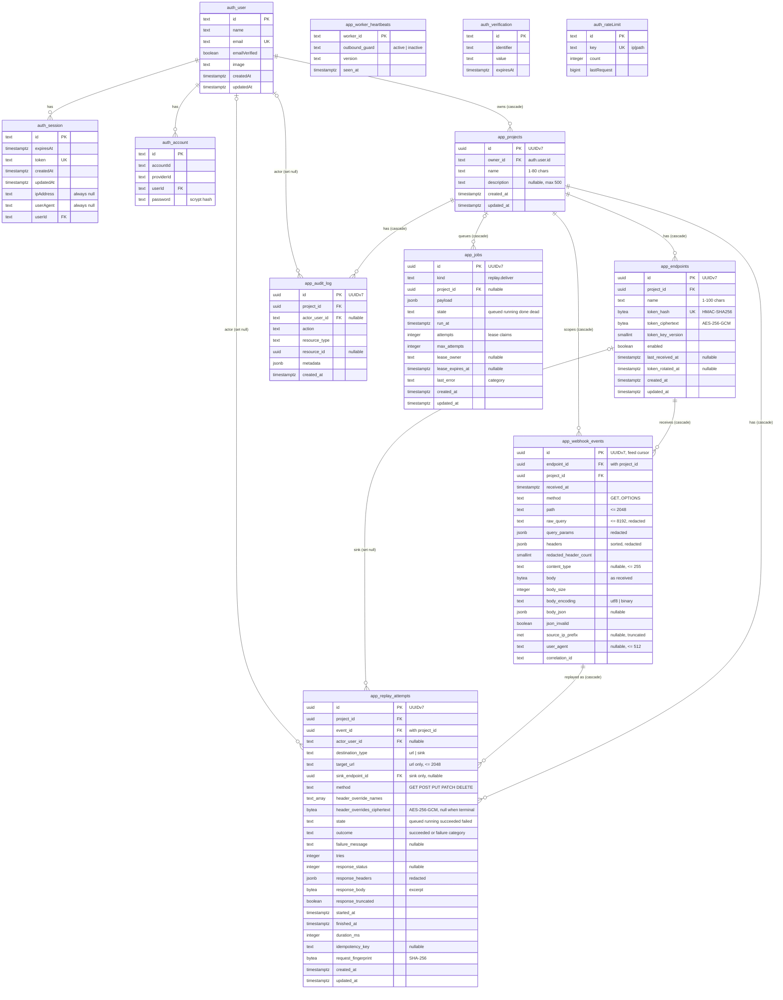

# Database schema (ERD)

This document describes the **actual** schema created by the goose migrations
in `backend/migrations/`, the Better Auth migrations run by
`pnpm --filter @relaylab/auth migrate`, and `deploy/sql/roles.sql`. It is
updated by every change that alters the schema.

## Current state

The `auth` schema holds Better Auth's tables (users, sessions, credentials).
The `app` schema holds `projects` (owned by `auth."user"` across schemas),
their webhook `endpoints`, the received `webhook_events`, the shared
`audit_log`, the `replay_attempts` of events, the background `jobs` queue,
and `worker_heartbeats`.

## Schemas and ownership

| Schema | Owner role | Managed by | Contents today |
|---|---|---|---|
| `app` | `app_migrator` | goose migrations in `backend/migrations/` | `projects`, `endpoints`, `webhook_events`, `audit_log`, `replay_attempts`, `jobs`, `worker_heartbeats`, `goose_db_version` (migration bookkeeping) |
| `auth` | `auth_migrator` | Better Auth 1.7.18 migrations (`auth/src/migrate.ts`) | `user`, `session`, `account`, `verification`, `rateLimit` |

Nothing is created in `public`; `CREATE` on `public` is revoked.

## Tables

### `app.goose_db_version`

goose's migration history. Created and owned by `app_migrator`; `app_runtime`
can read it so `/readyz` can compare applied and embedded versions.

| Column | Type | Notes |
|---|---|---|
| `id` | integer, identity | Primary key |
| `version_id` | bigint | Migration version |
| `is_applied` | boolean | Whether the version is applied |
| `tstamp` | timestamp without time zone | When the row was written (set by goose) |

### `app.projects`

User-owned projects: the isolation boundary for everything inside them.
Created by `backend/migrations/00002_projects.sql`.

| Column | Type | Notes |
|---|---|---|
| `id` | uuid | Primary key. UUIDv7 generated by the API (non-sequential to clients) |
| `owner_id` | text, not null | FK → `auth."user"(id)` **`ON DELETE CASCADE`** (cross-schema) |
| `name` | text, not null | `CHECK` 1–80 characters. Not unique per owner |
| `description` | text, nullable | `CHECK` at most 500 characters |
| `created_at` | timestamptz, not null | Default `now()` |
| `updated_at` | timestamptz, not null | Default `now()`; set on every update |

Index: `projects_owner_created_idx (owner_id, created_at DESC)`, used by the
owner-scoped list and the per-owner count. Every query filters by `owner_id`;
none loads a project by id alone.

The migration refuses to run if `auth."user"` does not exist: the auth
migrations must run first.

### `app.endpoints`

Webhook receiving endpoints. Created by `backend/migrations/00003_endpoints.sql`.
The receiving URL is `INGEST_BASE_URL + "/h/" + token`; the token itself is
never stored.

| Column | Type | Notes |
|---|---|---|
| `id` | uuid | Primary key, UUIDv7 |
| `project_id` | uuid, not null | FK → `app.projects(id)` **`ON DELETE CASCADE`** |
| `name` | text, not null | `CHECK` 1–100 characters |
| `token_hash` | bytea, not null | `HMAC-SHA256(ENDPOINT_TOKEN_HMAC_KEY, token)`, exactly 32 bytes, **unique**. Ingestion looks endpoints up by this hash |
| `token_ciphertext` | bytea, not null | `AES-256-GCM(ENDPOINT_TOKEN_ENC_KEY, token)`: 12-byte nonce + ciphertext + tag. The project and endpoint ids are additional authenticated data, so a ciphertext cannot be moved to another row |
| `token_key_version` | smallint, not null | Default 1; allows encryption-key rotation later |
| `enabled` | boolean, not null | Default true. Disabled endpoints keep their token and events |
| `last_received_at` | timestamptz, nullable | Set by ingestion |
| `token_rotated_at` | timestamptz, nullable | Last token rotation |
| `created_at`, `updated_at` | timestamptz, not null | Default `now()` |

Indexes and keys: `endpoints_token_hash_key` (unique `token_hash`),
`endpoints_id_project_key` (unique `(id, project_id)`, the target of the
`webhook_events` and `replay_attempts` composite foreign keys; added by `00004_webhook_events.sql`),
and `endpoints_project_created_idx (project_id, created_at DESC)` for the
owner-scoped, newest-first list. At most `LIMIT_ENDPOINTS_PER_PROJECT`
endpoints per project (default 25).

### `app.webhook_events`

One row per accepted webhook request, inserted before the sender is
acknowledged and never updated. Created by
`backend/migrations/00004_webhook_events.sql`. Sensitive header and query values
are replaced with `[REDACTED]` before the insert, so original credentials are
never stored; the body is stored exactly as received.

| Column | Type | Notes |
|---|---|---|
| `id` | uuid | Primary key, UUIDv7 (time-ordered; the event feed cursor) |
| `endpoint_id` | uuid, not null | With `project_id`: composite FK → `app.endpoints(id, project_id)` **`ON DELETE CASCADE`**, so an event always belongs to its endpoint's project |
| `project_id` | uuid, not null | FK → `app.projects(id)` **`ON DELETE CASCADE`**; denormalized for project-scoped queries |
| `received_at` | timestamptz, not null | Receive time, UTC |
| `method` | text, not null | `CHECK` one of `GET`, `POST`, `PUT`, `PATCH`, `DELETE`, `HEAD`, `OPTIONS` |
| `path` | text, not null | Subpath after the token (`''` for none), at most 2048 characters |
| `raw_query` | text, not null | Default `''`, at most 8192 characters; sensitive values replaced |
| `query_params` | jsonb, not null | Object `{name: [values]}`; sensitive values replaced |
| `headers` | jsonb, not null | Array `[[name, value], ...]` sorted by canonical name, repeated values in arrival order; sensitive values replaced |
| `redacted_header_count` | smallint, not null | Number of header values replaced at receipt (default 0) |
| `content_type` | text, nullable | Received value, truncated to 255 characters |
| `body` | bytea, not null | Raw body bytes, unmodified |
| `body_size` | integer, not null | `CHECK` equals `octet_length(body)` |
| `body_encoding` | text, not null | `utf8` or `binary` |
| `body_json` | jsonb, nullable | Parsed copy when the content type is JSON and the body parses (nesting up to 64 levels) |
| `json_invalid` | boolean, not null | JSON content type but the body did not parse; never true together with `body_json` |
| `source_ip_prefix` | inet, nullable | Client address truncated to IPv4 /24 or IPv6 /48 |
| `user_agent` | text, nullable | Truncated to 512 characters |
| `correlation_id` | text, not null | The request id (1–64 characters) |

Indexes: `webhook_events_project_id_idx (project_id, id DESC)` for the project
feed and cursor, `webhook_events_endpoint_id_idx (endpoint_id, id DESC)`,
`webhook_events_project_method_idx (project_id, method, id DESC)`, and
`webhook_events_project_received_idx (project_id, received_at)` for retention.
`webhook_events_id_project_key` (unique `(id, project_id)`, added by
`00005_replay.sql`) is the target of the `replay_attempts` composite foreign key.

### `app.audit_log`

Who did what to which project resource. Shared by every module that audits
actions; created by `00003_endpoints.sql`. It never contains tokens, URLs,
secrets, or payloads.

| Column | Type | Notes |
|---|---|---|
| `id` | uuid | Primary key, UUIDv7 |
| `project_id` | uuid, not null | FK → `app.projects(id)` **`ON DELETE CASCADE`** |
| `actor_user_id` | text, nullable | FK → `auth."user"(id)` **`ON DELETE SET NULL`** |
| `action` | text, not null | For example `endpoint.created`, `endpoint.rotated` (1–64 characters) |
| `resource_type` | text, not null | For example `endpoint` |
| `resource_id` | uuid, nullable | The affected resource |
| `metadata` | jsonb, not null | A JSON object; for endpoints only the id and name |
| `created_at` | timestamptz, not null | Default `now()` |

Index: `audit_log_project_created_idx (project_id, created_at DESC, id DESC)`.

### `app.replay_attempts`

One row per replay a user starts; `tries` counts deliveries within it.
Created by `backend/migrations/00005_replay.sql`. The original event is never
changed by a replay.

| Column | Type | Notes |
|---|---|---|
| `id` | uuid | Primary key, UUIDv7; sent to destinations as `X-RelayLab-Replay-Id` |
| `project_id` | uuid, not null | FK → `app.projects(id)` **`ON DELETE CASCADE`** |
| `event_id` | uuid, not null | With `project_id`: composite FK → `app.webhook_events(id, project_id)` **`ON DELETE CASCADE`**, so the event is in the same project |
| `actor_user_id` | text, nullable | FK → `auth."user"(id)` **`ON DELETE SET NULL`** |
| `destination_type` | text, not null | `url` or `sink` |
| `target_url` | text, nullable | The URL as entered (1–2048 characters); set exactly for `url` replays |
| `sink_endpoint_id` | uuid, nullable | With `project_id`: composite FK → `app.endpoints(id, project_id)` **`ON DELETE SET NULL (sink_endpoint_id)`**: the sink is in the same project, and deleting it keeps the replay. Never set for `url` replays |
| `method` | text, not null | `GET`, `POST`, `PUT`, `PATCH`, or `DELETE` |
| `header_override_names` | text[], not null | Names of headers the user added (values are never stored in plaintext) |
| `header_overrides_ciphertext` | bytea, nullable | AES-256-GCM of the override values. **Null once the replay is terminal** (`CHECK`) |
| `state` | text, not null | `queued`, `running`, `succeeded`, `failed` |
| `outcome` | text, nullable | Set exactly when terminal (`CHECK`): `succeeded` or a failure category (`blocked_address`, `timeout`, `sink_disabled`, `worker_lost`, ...) |
| `failure_message` | text, nullable | Safe, fixed message per category (at most 300 characters); never addresses or raw errors |
| `tries` | integer, not null | Deliveries made (at most `REPLAY_MAX_TRIES`) |
| `response_status` | integer, nullable | Status of the final try |
| `response_headers` | jsonb, nullable | `[[name, value], ...]`, sensitive values `[REDACTED]` |
| `response_body` | bytea, nullable | Body excerpt, at most `REPLAY_RESPONSE_EXCERPT_BYTES` |
| `response_truncated` | boolean, not null | The body was longer than the excerpt |
| `started_at`, `finished_at` | timestamptz, nullable | First claim and terminal time |
| `duration_ms` | integer, nullable | Total delivery time |
| `idempotency_key` | text, nullable | Client `Idempotency-Key` (1–128 characters), honoured for 24 hours |
| `request_fingerprint` | bytea, nullable | SHA-256 of the canonical create request, compared on key reuse |
| `created_at`, `updated_at` | timestamptz, not null | Default `now()` |

Indexes: `replay_attempts_idempotency_idx` (unique `(project_id,
idempotency_key)` where a key is set), `replay_attempts_project_created_idx
(project_id, created_at DESC, id DESC)` for history,
`replay_attempts_event_created_idx (event_id, created_at DESC, id DESC)` for an
event's replays, `replay_attempts_active_idx (project_id, state)` for queued
and running replays (queue-depth limit), and `replay_attempts_sink_idx`.

### `app.jobs`

The background job queue (D5), used by the worker for `replay.deliver`.
Workers claim jobs with `FOR UPDATE SKIP LOCKED` and hold a lease; only the
lease holder may finish a job.

| Column | Type | Notes |
|---|---|---|
| `id` | uuid | Primary key, UUIDv7 |
| `kind` | text, not null | `replay.deliver` (1–64 characters) |
| `project_id` | uuid, nullable | FK → `app.projects(id)` **`ON DELETE CASCADE`**: deleting a project removes its queued and running jobs |
| `payload` | jsonb, not null | A JSON object; for replays `{"replay_id": ...}` |
| `state` | text, not null | `queued`, `running`, `done`, `dead` |
| `run_at` | timestamptz, not null | Not claimed before this time |
| `attempts` | integer, not null | Times claimed. A job whose lease expires `max_attempts` times becomes `dead` |
| `max_attempts` | integer, not null | `REPLAY_MAX_LEASE_LOSSES` for replays |
| `lease_owner`, `lease_expires_at` | text, timestamptz, nullable | Set exactly while `running` (`CHECK`) |
| `last_error` | text, nullable | A category such as `lease_expired`, at most 200 characters; never raw errors |
| `created_at`, `updated_at` | timestamptz, not null | Default `now()` |

Indexes: `jobs_queued_run_at_idx (run_at) WHERE state = 'queued'`,
`jobs_project_state_idx (project_id, state)` for per-project concurrency, and
`jobs_running_lease_idx (lease_expires_at) WHERE state = 'running'` for the
reaper.

### `app.worker_heartbeats`

Each worker reports its outbound guard self-check here every 15 seconds. The
API offers URL replay only while some worker reported `active` within 60
seconds.

| Column | Type | Notes |
|---|---|---|
| `worker_id` | text | Primary key (1–128 characters) |
| `outbound_guard` | text, not null | `active` or `inactive` |
| `version` | text, not null | Worker build revision |
| `seen_at` | timestamptz, not null | Last heartbeat; rows older than a day are deleted by workers |

### `auth` tables (created by Better Auth)

Column names are camelCase and must be quoted in SQL (`"userId"`). The Go API
reads only `user` and `session`, through one query
(`backend/db/queries/identity.sql`); `backend/db/sqlc/10_auth_tables.sql`
declares those two tables for sqlc only.

| Table | Purpose | Key columns and constraints | Indexes |
|---|---|---|---|
| `auth."user"` | Accounts | `id text` PK (random string); `email text` UNIQUE, stored lowercase; `name text`; `"emailVerified" boolean`; `image text` (unused) | `user_pkey`, `user_email_key` |
| `auth."session"` | Active sessions | `id text` PK; `token text` UNIQUE (the cookie's token); `"expiresAt" timestamptz`; `"userId" text` FK → `user.id` `ON DELETE CASCADE`; `"ipAddress"`, `"userAgent"` always `NULL` (privacy hook) | `session_pkey`, `session_token_key`, `session_userId_idx` |
| `auth.account` | Credentials per provider. Email and password only: `providerId = 'credential'`, `password` is a scrypt hash | `"userId"` FK → `user.id` `ON DELETE CASCADE`; OAuth token columns unused | `account_pkey`, `account_userId_idx` |
| `auth.verification` | Single-use email-verification and password-reset tokens | `identifier`, `value`, `"expiresAt"` (verification: 24 h; reset: 1 h) | `verification_pkey`, `verification_identifier_idx` |
| `auth."rateLimit"` | Per-IP request counters for sign-in, sign-up, reset, and verification emails | `key text` UNIQUE (`<ip>|<path>`); `count integer`; `"lastRequest" bigint` (ms) | `rateLimit_pkey`, `rateLimit_key_key` |

Cardinality: a user has zero or more sessions, one credential account, and up
to `LIMIT_PROJECTS_PER_USER` projects (default 20). Deleting a user deletes
their sessions, accounts, and projects.

## Roles and privileges

| Role | Privileges |
|---|---|
| `app_migrator` | Owns `app`; DDL there; `USAGE` on `auth` and `REFERENCES` on `auth."user"` (for app foreign keys) |
| `app_runtime` | `USAGE` on `app`; `SELECT, INSERT, UPDATE, DELETE` on tables `app_migrator` creates (default privileges); `USAGE` on `auth` and **`SELECT` on `auth."session"` and `auth."user"` only** (granted by the auth migrate command; writes are denied, enforced by tests) |
| `auth_migrator` | Owns `auth`; DDL there |
| `auth_runtime` | `USAGE` on `auth`; data access to tables `auth_migrator` creates |

## Retention and deletion

**Permanent deletion contract (D18).** Deleting a project is a single
`DELETE FROM app.projects WHERE id = $1 AND owner_id = $2`; everything scoped
to the project goes with it through foreign-key cascades. Every later
project-scoped table must reference `app.projects(id) ON DELETE CASCADE`
through a `project_id` column and be registered in
`backend/internal/testutil/deletion/tables.go`. Tests enforce this: any `app`
table with an uncascaded or unregistered `project_id` fails the suite, and
deleting a project or its owner must leave no rows behind. There is no archive
or restore.

- **Projects**: kept until the owner deletes them (type-to-confirm in project settings) or deletes their account.
- **Endpoints**: kept until the owner deletes the endpoint (type-to-confirm) or its project. Deleting an endpoint removes its events and, through them, their replays; replays that used it as a sink are kept with `sink_endpoint_id` cleared. Rotating its token keeps everything.
- **Webhook events**: kept until their endpoint or project is deleted (by cascade). An age-based retention purge is planned in `add-event-retention`; until then events have no automatic expiry. Credential header and query values are never stored.
- **Replay attempts**: kept until their event or project is deleted (by cascade). Header override values are erased (ciphertext set to null) as soon as the replay is terminal; response excerpts are kept with the replay.
- **Jobs**: deleted with their project, including queued and running ones; a worker whose rows disappear mid-run stops without writing. Finished (`done`, `dead`) rows have no automatic expiry yet; purging them is planned in `add-event-retention`.
- **Worker heartbeats**: one row per worker; rows not updated for a day are deleted by running workers.
- **Audit log**: kept with its project and deleted with it. If the actor's account is deleted, `actor_user_id` becomes `NULL` (in practice the actor's projects, and so these rows, are deleted too).

- **Accounts**: kept until the user deletes their account (Account settings → Delete account), which removes the `user` row and, by cascade, its sessions, credentials, and projects (with their endpoints, events, and audit entries).
- **Sessions**: deleted on sign-out, sign-out everywhere, password change (other sessions), password reset (all sessions), and account deletion. Expired rows are rejected immediately but remain in the table until Better Auth removes them.
- **Verification and reset tokens**: single use; they expire after 24 hours and 1 hour respectively.
- **Rate-limit counters**: the only place a full IP address is stored (webhook events keep only a truncated prefix). Pruning old rows (by the auth service, which owns the schema) is planned in `add-event-retention`.
