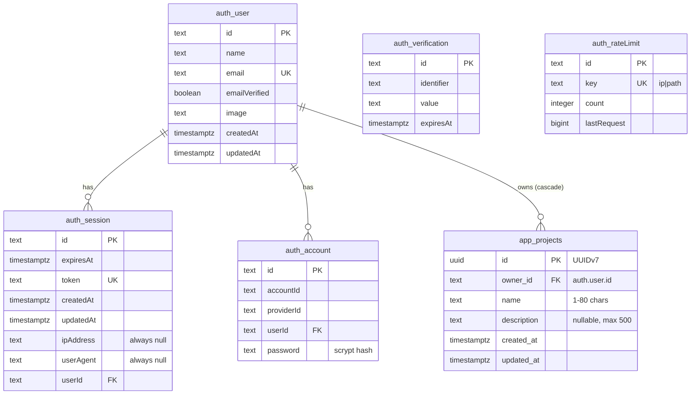

# Database schema (ERD)

This document describes the **actual** schema created by the goose migrations
in `backend/migrations/`, the Better Auth migrations run by
`pnpm --filter @relaylab/auth migrate`, and `deploy/sql/roles.sql`. It is
updated by every change that alters the schema.

## Current state

The `auth` schema holds Better Auth's tables (users, sessions, credentials).
The `app` schema holds `projects`, owned by `auth."user"` across schemas.
Endpoints, events, and replays are added by later changes, each cascading from
`app.projects`.

## Schemas and ownership

| Schema | Owner role | Managed by | Contents today |
|---|---|---|---|
| `app` | `app_migrator` | goose migrations in `backend/migrations/` | `projects`, `goose_db_version` (migration bookkeeping) |
| `auth` | `auth_migrator` | Better Auth 1.7.18 migrations (`auth/src/migrate.ts`) | `user`, `session`, `account`, `verification`, `rateLimit` |

Nothing is created in `public`; `CREATE` on `public` is revoked.

## Tables

### `app.goose_db_version`

goose's migration history. Created and owned by `app_migrator`; `app_runtime`
can read it so `/readyz` can compare applied and embedded versions.

| Column | Type | Notes |
|---|---|---|
| `id` | integer, identity | Primary key |
| `version_id` | bigint | Migration version |
| `is_applied` | boolean | Whether the version is applied |
| `tstamp` | timestamp without time zone | When the row was written (set by goose) |

### `app.projects`

User-owned projects: the isolation boundary for everything inside them.
Created by `backend/migrations/00002_projects.sql`.

| Column | Type | Notes |
|---|---|---|
| `id` | uuid | Primary key. UUIDv7 generated by the API (non-sequential to clients) |
| `owner_id` | text, not null | FK → `auth."user"(id)` **`ON DELETE CASCADE`** (cross-schema) |
| `name` | text, not null | `CHECK` 1–80 characters. Not unique per owner |
| `description` | text, nullable | `CHECK` at most 500 characters |
| `created_at` | timestamptz, not null | Default `now()` |
| `updated_at` | timestamptz, not null | Default `now()`; set on every update |

Index: `projects_owner_created_idx (owner_id, created_at DESC)`, used by the
owner-scoped list and the per-owner count. Every query filters by `owner_id`;
none loads a project by id alone.

The migration refuses to run if `auth."user"` does not exist: the auth
migrations must run first.

### `auth` tables (created by Better Auth)

Column names are camelCase and must be quoted in SQL (`"userId"`). The Go API
reads only `user` and `session`, through one query
(`backend/db/queries/identity.sql`); `backend/db/sqlc/10_auth_tables.sql`
declares those two tables for sqlc only.

| Table | Purpose | Key columns and constraints | Indexes |
|---|---|---|---|
| `auth."user"` | Accounts | `id text` PK (random string); `email text` UNIQUE, stored lowercase; `name text`; `"emailVerified" boolean`; `image text` (unused) | `user_pkey`, `user_email_key` |
| `auth."session"` | Active sessions | `id text` PK; `token text` UNIQUE (the cookie's token); `"expiresAt" timestamptz`; `"userId" text` FK → `user.id` `ON DELETE CASCADE`; `"ipAddress"`, `"userAgent"` always `NULL` (privacy hook) | `session_pkey`, `session_token_key`, `session_userId_idx` |
| `auth.account` | Credentials per provider. Email and password only: `providerId = 'credential'`, `password` is a scrypt hash | `"userId"` FK → `user.id` `ON DELETE CASCADE`; OAuth token columns unused | `account_pkey`, `account_userId_idx` |
| `auth.verification` | Single-use email-verification and password-reset tokens | `identifier`, `value`, `"expiresAt"` (verification: 24 h; reset: 1 h) | `verification_pkey`, `verification_identifier_idx` |
| `auth."rateLimit"` | Per-IP request counters for sign-in, sign-up, reset, and verification emails | `key text` UNIQUE (`<ip>|<path>`); `count integer`; `"lastRequest" bigint` (ms) | `rateLimit_pkey`, `rateLimit_key_key` |

Cardinality: a user has zero or more sessions, one credential account, and up
to `LIMIT_PROJECTS_PER_USER` projects (default 20). Deleting a user deletes
their sessions, accounts, and projects.

## Roles and privileges

| Role | Privileges |
|---|---|
| `app_migrator` | Owns `app`; DDL there; `USAGE` on `auth` and `REFERENCES` on `auth."user"` (for app foreign keys) |
| `app_runtime` | `USAGE` on `app`; `SELECT, INSERT, UPDATE, DELETE` on tables `app_migrator` creates (default privileges); `USAGE` on `auth` and **`SELECT` on `auth."session"` and `auth."user"` only** (granted by the auth migrate command; writes are denied, enforced by tests) |
| `auth_migrator` | Owns `auth`; DDL there |
| `auth_runtime` | `USAGE` on `auth`; data access to tables `auth_migrator` creates |

## Retention and deletion

**Permanent deletion contract (D18).** Deleting a project is a single
`DELETE FROM app.projects WHERE id = $1 AND owner_id = $2`; everything scoped
to the project goes with it through foreign-key cascades. Every later
project-scoped table must reference `app.projects(id) ON DELETE CASCADE`
through a `project_id` column and be registered in
`backend/internal/testutil/deletion/tables.go`. Tests enforce this: any `app`
table with an uncascaded or unregistered `project_id` fails the suite, and
deleting a project or its owner must leave no rows behind. There is no archive
or restore.

- **Projects**: kept until the owner deletes them (type-to-confirm in project settings) or deletes their account.

- **Accounts**: kept until the user deletes their account (Account settings → Delete account), which removes the `user` row and, by cascade, its sessions and credentials. Later changes cascade the user's projects and data too.
- **Sessions**: deleted on sign-out, sign-out everywhere, password change (other sessions), password reset (all sessions), and account deletion. Expired rows are rejected immediately but remain in the table until Better Auth removes them.
- **Verification and reset tokens**: single use; they expire after 24 hours and 1 hour respectively.
- **Rate-limit counters**: the only place an IP address is stored. Pruning old rows (by the auth service, which owns the schema) is planned in `add-event-retention`.
