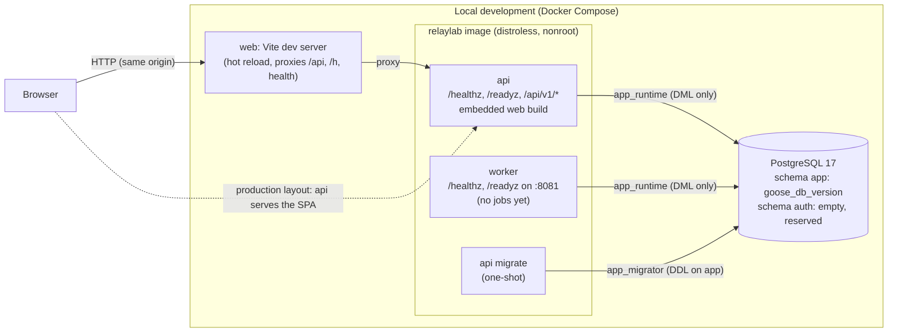

# Architecture overview

This diagram shows what is **implemented today**. It grows as changes ship. The
target architecture and decisions are in [`docs/plan/mvp-plan.md`](../plan/mvp-plan.md).

## Request path through the API

Every request passes through the same middleware, in this order:

1. **Request ID**: reuse a safe `X-Request-ID` or generate one; attach a request-scoped logger.
2. **Real IP**: trust `X-Forwarded-For` only from `TRUSTED_PROXY_CIDRS`.
3. **Access log**: one JSON line per request with the route pattern, status, duration, and size.
4. **Recoverer**: panics become `500 internal_error`; the stack trace goes to logs only.
5. **Security headers**: `nosniff`, `Referrer-Policy`, `X-Frame-Options: DENY`, and a CSP without inline scripts.
6. **Header limit**: `431 headers_too_large` above `LIMIT_HTTP_MAX_HEADER_BYTES`.

`/api/*` additionally applies `LIMIT_API_MAX_BODY_BYTES`. Unknown `/api` and
`/h` paths return the JSON error envelope. Other `GET` paths fall back to the
web app when it is embedded.

## Trust boundaries (current)

- **Database privileges**: the API and worker connect as `app_runtime`, which
  cannot create, alter, or drop objects. Only the `migrate` command uses
  `app_migrator`.
- **Configuration**: secrets are typed so they cannot be printed by logs or
  error messages.
- **Not yet present**: authentication, public webhook ingestion, and outbound
  replay. Their boundaries are added to this diagram by the changes that
  implement them.
