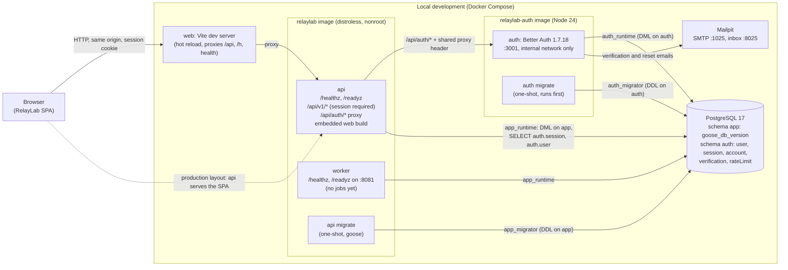

# Architecture overview

This diagram shows what is **implemented today**. It grows as changes ship. The
target architecture and decisions are in [`docs/plan/mvp-plan.md`](../plan/mvp-plan.md).

## Request path through the API

Every request passes through the same middleware, in this order:

1. **Request ID**: reuse a safe `X-Request-ID` or generate one; attach a request-scoped logger.
2. **Real IP**: trust `X-Forwarded-For` only from `TRUSTED_PROXY_CIDRS`.
3. **Access log**: one JSON line per request with the route pattern, status, duration, and size.
4. **Recoverer**: panics become `500 internal_error`; the stack trace goes to logs only.
5. **Security headers**: `nosniff`, `Referrer-Policy`, `X-Frame-Options: DENY`, and a CSP without inline scripts.
6. **Header limit**: `431 headers_too_large` above `LIMIT_HTTP_MAX_HEADER_BYTES`.

`/api/*` additionally applies `LIMIT_API_MAX_BODY_BYTES`. Then:

- **`/api/auth/*`** is reverse-proxied to the auth service: hop-by-hop and client-supplied forwarding headers are removed, `X-Forwarded-For` is set to the derived client IP, the shared `X-RelayLab-Proxy` header is added, and the request is bounded by `LIMIT_AUTH_PROXY_TIMEOUT_SECONDS`.
- **`/api/v1/*`** applies, in order: the same-origin check on unsafe methods (`403 origin_rejected`), the JSON content-type check (`415`), and session validation (`401`/`403`) on every route except `GET /api/v1/config`.

Unknown `/api` and `/h` paths return the JSON error envelope. Other `GET` paths
fall back to the web app when it is embedded.

## Trust boundaries (current)

- **Authentication**: one origin for the SPA, the API, and authentication; no
  CORS. The Go API validates every `/api/v1` session itself (signature check,
  then a read-only lookup) and takes the acting user only from that session.
  The auth service is reachable only through the API proxy, which proves itself
  with a shared secret. Details: [Authentication and sessions](../security/authentication.md).
- **Database privileges**: the API and worker connect as `app_runtime`, which
  cannot create, alter, or drop objects, and can only read two `auth` tables.
  The auth service connects as `auth_runtime`. Only the migrate commands use
  `app_migrator` and `auth_migrator`.
- **Configuration**: secrets are typed so they cannot be printed by logs or
  error messages. The worker does not receive the session secret.
- **Not yet present**: public webhook ingestion and outbound replay. Their
  boundaries are added to this diagram by the changes that implement them.

In production (prepared by `add-production-readiness`), the auth service runs
as a sidecar in the same Cloud Run service as the API, so `AUTH_SERVICE_URL`
is `http://localhost:3001` and the port is never exposed.
