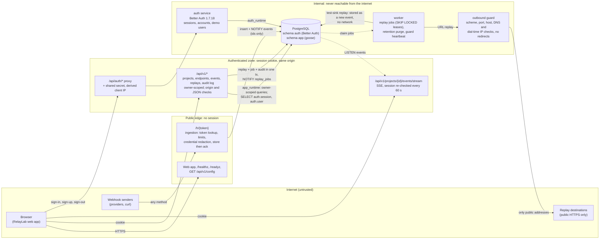
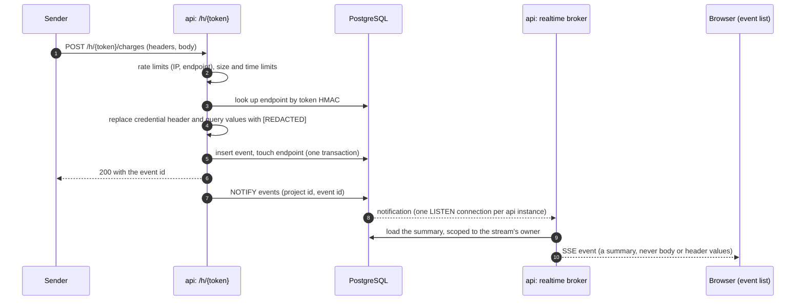
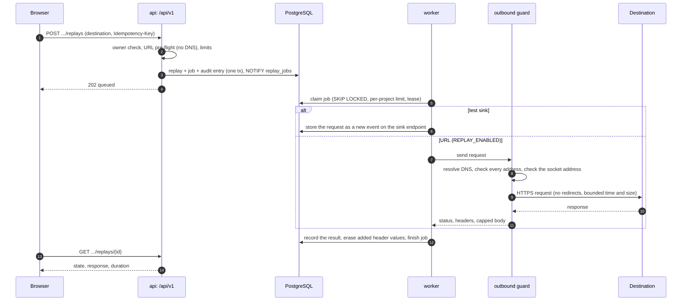

# Architecture overview

This page shows what is **implemented today**: three running processes
(`api`, `worker`, and the Better Auth `auth` service), two one-shot migration
steps, and PostgreSQL. The decisions behind it are recorded in
[`docs/decisions/`](../decisions/README.md); the deployment layout is in
[`docs/deployment.md`](../deployment.md).

## Components and trust boundaries

All three processes run from two images: `relaylab` (Go: `api`, `api
migrate`, `worker`) and `relaylab-auth` (Node: the auth service and its
migrate command). Locally, Docker Compose also runs Mailpit (SMTP) and,
during development, the Vite dev server in front of the api.

## Inbound webhook flow

## Replay flow

## Request path through the API

Every request passes through the same middleware, in this order:

1. **Request ID**: reuse a safe `X-Request-ID` or generate one; attach a request-scoped logger.
2. **Real IP**: trust `X-Forwarded-For` only from `TRUSTED_PROXY_CIDRS`.
3. **Access log**: one JSON line per request with the route pattern, status, duration, and size.
4. **Recoverer**: panics become `500 internal_error`; the stack trace goes to logs only.
5. **Security headers**: `nosniff`, `Referrer-Policy`, `X-Frame-Options: DENY`, and a CSP without inline scripts.
6. **Header limit**: `431 headers_too_large` above `LIMIT_HTTP_MAX_HEADER_BYTES`.

`/api/*` additionally applies `LIMIT_API_MAX_BODY_BYTES`. Then:

- **`/api/auth/*`** is reverse-proxied to the auth service: hop-by-hop and client-supplied forwarding headers are removed, `X-Forwarded-For` is set to the derived client IP, the shared `X-RelayLab-Proxy` header is added, and the request is bounded by `LIMIT_AUTH_PROXY_TIMEOUT_SECONDS`.
- **`/api/v1/*`** applies, in order: the same-origin check on unsafe methods (`403 origin_rejected`), the JSON content-type check (`415`), and session validation (`401`/`403`) on every route except `GET /api/v1/config`.

Unknown `/api` and `/h` paths return the JSON error envelope. Other `GET` paths
fall back to the web app when it is embedded.

## Trust boundaries (current)

- **Authentication**: one origin for the SPA, the API, and authentication; no
  CORS. The Go API validates every `/api/v1` session itself (signature check,
  then a read-only lookup) and takes the acting user only from that session.
  The auth service is reachable only through the API proxy, which proves itself
  with a shared secret. Details: [Authentication and sessions](auth.md).
- **Database privileges**: the API and worker connect as `app_runtime`, which
  cannot create, alter, or drop objects, and can only read two `auth` tables.
  The auth service connects as `auth_runtime`. Only the migrate commands use
  `app_migrator` and `auth_migrator`.
- **Configuration**: secrets are typed so they cannot be printed by logs or
  error messages. The worker does not receive the session secret.
- **Public ingestion**: `/h/{token}` accepts untrusted requests without a
  session. The unguessable token is the only credential. Ingestion never reads
  the session cookie, can only insert events, and removes credential values
  before storing them. Details: [API reference](../api.md#webhook-ingestion-h).
- **Event explorer**: `/api/v1/projects/{id}/events` reads events only for the
  session user's projects, and the web app renders all received content as
  inert text. Details: [Received events](../security/events.md).
- **Live updates**: `/api/v1/projects/{id}/events/stream` requires the same
  session and ownership as the REST routes, re-validates both at least every
  60 s and at session expiry, and is capped per user. Database notifications
  carry ids only. Each stream loads summaries with an owner-scoped query, and
  summaries never include bodies, headers, or query values. Details:
  [API reference](../api.md#get-apiv1projectsprojectideventsstream).
- **Outbound requests (replay)**: the API validates and queues replays
  (`/api/v1/projects/{id}/events/{eventId}/replays`, owner-only; URL
  replays only behind `REPLAY_ENABLED` and a fresh worker heartbeat). The worker claims them from
  `app.jobs` and is the only process that sends user-directed requests,
  through `internal/replay/outbound`: HTTPS only, public addresses only
  (checked on every DNS answer and on the socket itself), no redirects,
  internal and RelayLab hosts blocked, and bounded time, size, and
  concurrency. Test-sink replays never open a socket: they are stored as new
  events through the ingestion insert path. Credential and signature headers
  are never forwarded; values users add are encrypted until delivery.
  Details: [Outbound requests](../security/outbound-replay.md).
- **Demo workspaces**: "Try the demo" signs in as a Better Auth anonymous
  user (`DEMO_ENABLED`). The Go API recognises demo users from the session,
  seeds each one a workspace on their first request, applies lower limits,
  and allows replay to the test sink only. The auth service deletes demo
  users after `DEMO_TTL`, and their data goes by cascade.
- **Retention**: one worker at a time (Postgres advisory lock) deletes events
  past `RETENTION_EVENT_TTL` or beyond the per-project cap, old audit entries,
  and finished jobs, in batches of at most 1,000 rows. The worker has no write
  access to the `auth` schema; the auth service prunes its own rate-limit
  rows. Details: [Data retention and deletion](../security/data-retention.md).

In production (prepared, not deployed: see [Deployment](../deployment.md)),
the auth service runs as a sidecar in the same Cloud Run service as the API,
so `AUTH_SERVICE_URL` is `http://localhost:3001` and the port is never
exposed. Request traffic may go through a transaction-mode pooler
(`DATABASE_URL`); `LISTEN` and the retention lock use a direct connection
(`DATABASE_DIRECT_URL`).
