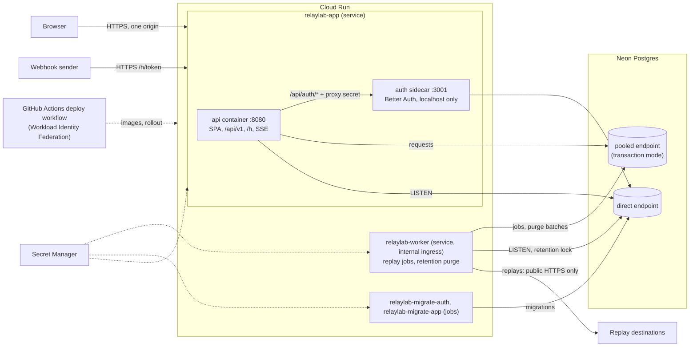

# Deployment

> **Status: RelayLab is not deployed.** There is no public demo URL and no
> cloud project yet. Everything on this page has been prepared and checked
> locally (manifests, images, the deploy workflow's dry run, and a
> production-mode stack), but nothing has been provisioned or run in the
> cloud. The `deploy-public-demo` change performs the first deployment by
> following the steps below.

Target: Google Cloud Run on the default `*.run.app` domain, with Neon
Postgres (Cloud SQL works the same way through standard connection URLs).

## Topology



- **One origin.** The api container serves the web app, the dashboard API,
  ingestion, and live streams, and proxies `/api/auth/*` to the auth service
  on `localhost:3001`. Session cookies are first-party and `Secure`.
- **Request timeout 3600 s** keeps live event streams open; every handler
  enforces its own shorter budget.
- **At most 3 app instances.** Rate limits are per instance, so the
  instance cap bounds them.
- **One worker**, always on (`min 1`, CPU always allocated), with internal
  ingress only. It is the only process that sends replays to URLs.
- **Migrations** run as two jobs, auth schema first (app tables reference
  `auth."user"`), before each rollout.

Definitions: `deploy/cloudrun/` (`app.yaml`, `worker.yaml`,
`migrate-auth-job.yaml`, `migrate-app-job.yaml`), rendered by
`deploy/render.sh`.

## Configuration

### Deploy-time variables

`deploy/render.sh <out-dir>` substitutes these into the manifests. None is a
secret. The deploy workflow reads them from the GitHub `production`
environment's variables.

| Variable | Example | Purpose |
|---|---|---|
| `REGION` (`GCP_REGION` in GitHub) | `europe-north1` | Cloud Run region |
| `IMAGE_APP`, `IMAGE_AUTH` | `…/relaylab/app@sha256:…` | Image digests; the workflow sets them after pushing |
| `APP_ORIGIN` | `https://relaylab-app-xxxx.a.run.app` | The public origin (also the ingestion base URL) |
| `APP_SERVICE_ACCOUNT`, `WORKER_SERVICE_ACCOUNT`, `MIGRATE_SERVICE_ACCOUNT` | `relaylab-app@<project>.iam.gserviceaccount.com` | Runtime identities |
| `TRUSTED_PROXY_CIDRS` | (see [First deployment checks](#first-deployment-checks)) | Which peers may set `X-Forwarded-For` |
| `REPLAY_ENABLED` | `false` | Replay to URLs; test-sink replay always works |
| `DEMO_ENABLED` | `true` | Offer "Try the demo" |
| `RETENTION_EVENT_TTL` | `24h` | Event retention (24 h for the public demo) |
| `SMTP_HOST`, `SMTP_PORT`, `SMTP_USER`, `MAIL_FROM` | | Outgoing mail (verification and password-reset emails) |

The production profile (`APP_ENV=production`, set in the manifests) makes
every service refuse to start with an unsafe configuration: a non-HTTPS
origin, a database URL that allows plaintext, short secrets,
`OUTBOUND_ALLOW_HTTP`, `REPLAY_TEST_ALLOWLIST`, `RETENTION_EVENT_TTL=0`,
sign-up without `AUTH_ALLOW_PUBLIC_SIGNUP_ACK=true` and email verification,
or rate limiting turned off. Errors name the variable, never its value.

### Secrets

Create these in Secret Manager. The manifests reference them by name (`key:
latest`) and never contain values. Grant each runtime service account
`roles/secretmanager.secretAccessor` on the secrets its manifest lists.

| Secret | Used by | Value |
|---|---|---|
| `relaylab-database-url` | app (api), worker | Pooled URL as `app_runtime`, `sslmode=require` or stricter |
| `relaylab-database-direct-url` | app (api), worker | Direct URL as `app_runtime`, same TLS rule |
| `relaylab-auth-database-url` | app (auth) | Direct URL as `auth_runtime` |
| `relaylab-auth-migrator-url` | migrate-auth job | Direct URL as `auth_migrator` |
| `relaylab-app-migrator-url` | migrate-app job | Direct URL as `app_migrator` |
| `relaylab-better-auth-secret` | app (api, auth) | 32+ random characters: `openssl rand -base64 48` |
| `relaylab-auth-proxy-secret` | app (api, auth) | Different 32+ random characters |
| `relaylab-endpoint-token-hmac-key`, `relaylab-endpoint-token-enc-key` | app (api) | 32 bytes each, base64: `openssl rand -base64 32` |
| `relaylab-replay-override-key` | app (api), worker | 32 bytes, base64 |
| `relaylab-smtp-password` | app (auth) | The SMTP password |

Never reuse development values: `.env.example` and the local stacks use
published placeholders.

## Database

The app uses only standard PostgreSQL (16 or newer) through connection
URLs, so Neon and Cloud SQL are interchangeable. In production every URL
must require TLS (`sslmode=require`, `verify-ca`, or `verify-full`); a Unix
socket (Cloud SQL connector, `host=/cloudsql/...`) is also accepted.

**Two kinds of URL.** Request traffic may go through a transaction-mode
pooler (Neon's pooled endpoint, PgBouncer): the app uses no named prepared
statements by default. `LISTEN` and the retention purge's session lock need
a direct connection: set `DATABASE_DIRECT_URL` to the direct endpoint. The
auth service and the migration jobs use direct URLs.

### Neon

1. Create a project and a database named `relaylab`.
2. Connect with the direct URL as the owner role (`neondb_owner`) and create
   the roles and schemas, with the role passwords as session settings:

   ```sh
   PGOPTIONS="-c relaylab.app_migrator_password=… -c relaylab.app_runtime_password=… \
              -c relaylab.auth_migrator_password=… -c relaylab.auth_runtime_password=…" \
   psql "postgres://neondb_owner:…@<direct-host>/relaylab?sslmode=require" \
     -v ON_ERROR_STOP=1 -f deploy/sql/roles.sql
   ```

   `roles.sql` works for a managed owner that is not a superuser, and is safe
   to re-run (it rotates the role passwords).
3. Store the five URLs in Secret Manager: pooled (`-pooler` host) for
   `relaylab-database-url`, direct for the others.

### Cloud SQL

Same steps with the `postgres` user as the owner. Connect either through
the Cloud SQL connector (add the instance to the services' Cloud SQL
connections and use `host=/cloudsql/<project>:<region>:<instance>` in the
URLs) or over private IP with `sslmode=verify-ca` and the server CA. Cloud
SQL has no built-in transaction pooler, so the pooled and direct URLs can be
the same.

## Migrations

The deploy workflow runs `relaylab-migrate-auth` (Better Auth, as
`auth_migrator`), then `relaylab-migrate-app` (goose, as `app_migrator`), and
waits for each. Both are idempotent. Migrations are forward-only and must be
backwards-compatible with the running revision (expand, deploy, then
contract in a later release), because the old revision serves traffic until
the new one passes its health check.

## Deploy workflow

`.github/workflows/deploy.yml` runs only when started by hand (Actions →
Deploy → Run workflow); a test asserts that no push, pull request, or
schedule can start it. It has never been run.

**One-time setup** (part of `deploy-public-demo`):

1. GCP project with Cloud Run, Artifact Registry, Secret Manager, IAM
   Credentials, and Cloud Monitoring APIs enabled; an Artifact Registry
   Docker repository.
2. Service accounts: app, worker, and migrate (runtime, secret access only),
   and a deploy account with `roles/run.admin`,
   `roles/artifactregistry.writer`, and `roles/iam.serviceAccountUser` on the
   runtime accounts.
3. Workload Identity Federation: a pool and GitHub OIDC provider restricted
   to this repository, allowed to impersonate the deploy account. No service
   account keys are created.
4. A GitHub environment named `production` with required reviewers, and the
   variables from the table above plus `GCP_PROJECT`, `ARTIFACT_REGISTRY`,
   `GCP_WORKLOAD_IDENTITY_PROVIDER`, and `GCP_DEPLOY_SERVICE_ACCOUNT`.

**A run** (inputs `ref`, `dry_run`):

1. Stops unless a CI run on that exact commit succeeded.
2. Validates the manifests offline and builds both images.
3. With `dry_run` (the default), stops here: nothing is pushed or deployed
   and no cloud API is called.
4. Otherwise: pushes the images and deploys them by digest, runs both
   migration jobs, deploys the worker, deploys the app as a new revision with
   **no traffic** under a `sha-<commit>` tag, checks `/healthz` and `/readyz`
   on the tag URL, and only then moves all traffic to it. If any step fails,
   traffic stays on the previous revision.

The same checks run locally: `pnpm deploy:check` (manifest validation and
actionlint).

## Rollback

- **App:** move traffic back to the previous revision:
  `gcloud run services update-traffic relaylab-app --region <region> --to-revisions <previous-revision>=100`.
  `gcloud run revisions list --service relaylab-app` lists revisions.
- **Worker:** the same with `relaylab-worker`.
- **Database:** migrations are forward-only. Roll back the code, not the
  schema; because migrations are backwards-compatible, the previous revision
  runs on the newer schema. Neon branches or Cloud SQL backups are the last
  resort for data, not for schema rollback.

## Monitoring

- **Logs:** every service writes one JSON line per entry with Cloud
  Logging's `severity`, a request id, and the trace when Cloud Run sends one
  (set `GOOGLE_CLOUD_PROJECT` to enable trace correlation). Logs never
  contain secrets, session tokens, credential header values, or webhook
  bodies.
- **Errors:** a panic is logged once as a Cloud Error Reporting event (with
  the stack in the log, never in the response); `severity=ERROR` entries
  cover the rest.
- **Built-in:** Cloud Run request, latency, and instance metrics; Neon's
  dashboard and notifications.
- **Optional alerts:** `deploy/monitoring/` holds an uptime check on
  `/readyz` and alert policies (uptime, 5xx rate) that notify a channel of
  the operator's choice (`ALERT_NOTIFICATION_CHANNEL`). They are not
  applied; see `deploy/monitoring/README.md`.
- **Worker metrics** (`/metrics` on the worker's port) cover replays, the
  job queue, the outbound guard, and retention. Cloud Run does not scrape
  them by default; reading them needs a managed Prometheus sidecar, which is
  not configured.

## Public demo settings

For the public demo: `DEMO_ENABLED=true` (visitors get a demo workspace:
synthetic data, one project, two endpoints, 200 events, replay to the test
sink only, deleted after 24 hours), `RETENTION_EVENT_TTL=24h`,
`REPLAY_ENABLED=false`, and sign-up closed. Real accounts are created with
the operator command (`node src/cli/create-user.ts` in the auth image,
password on stdin).

## Production-mode local check

Run the production images with the production profile on your machine, no
cloud account needed: TLS in front (Caddy, `https://localhost:8443`),
verified TLS to Postgres, request traffic through PgBouncer in transaction
mode with prepared statements off, and LISTEN on a direct connection.

```sh
docker compose -f docker-compose.prod.yml up -d --build --wait
scripts/prod-smoke.sh
docker compose -f docker-compose.prod.yml down -v
```

The smoke script checks health and readiness, production defaults, a demo
start with `Secure` cookies and a seeded workspace, ingestion, live arrival
over SSE, a test-sink replay, URL replay refused (demo user and replay off),
sign-up refused, no debug routes, and that no secret reaches any log.

## First deployment checks

Things that can only be confirmed on Cloud Run, for `deploy-public-demo`:

- **Client addresses.** Confirm what peer address the api sees behind
  Cloud Run's front end and set `TRUSTED_PROXY_CIDRS` so that per-IP rate
  limits use the real client address from `X-Forwarded-For`.
- **Sidecar start order and health:** the app revision starts the auth
  container first and both pass their `/readyz` startup probes.
- **Live streams** stay open up to the 3600 s request timeout and resume
  after it.
- **Cookies** are issued as `__Secure-relaylab.session_token` on the
  `*.run.app` origin.
