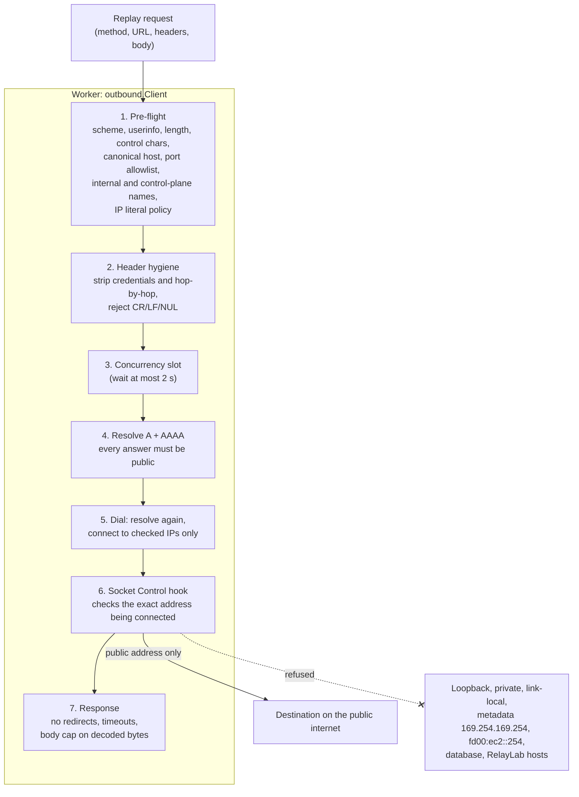

# Outbound requests (replay): SSRF protections

Replaying a webhook makes RelayLab send an HTTP request to a URL a user
chooses. That is a Server-Side Request Forgery (SSRF) boundary: without
controls, a user could make RelayLab reach cloud metadata, the database,
internal services, or RelayLab itself.

Every user-directed outbound request goes through one guarded client,
`backend/internal/replay/outbound`, in the worker. An architecture test fails
if any other package under `internal/replay` builds an HTTP client or dials.
Replay jobs, the API, and the UI ship with `add-event-replay` (see
[Replay](#replay) below); URL replay runs only while the guard is active.

## How a request is checked

Any failing step stops the request with one failure category. No bytes are
sent to a refused destination.

## Policy

- **Schemes**: `https` only. `http` (and port 80) only when
  `OUTBOUND_ALLOW_HTTP=true`, which the worker refuses to start with when
  `APP_ENV=production`.
- **Ports**: `OUTBOUND_ALLOWED_PORTS`, default `443,8443`.
- **Addresses**: IPv4 outside `0.0.0.0/8`, `10.0.0.0/8`, `100.64.0.0/10`,
  `127.0.0.0/8`, `169.254.0.0/16`, `172.16.0.0/12`, `192.0.0.0/24`,
  `192.0.2.0/24`, `192.88.99.0/24`, `192.168.0.0/16`, `198.18.0.0/15`,
  `198.51.100.0/24`, `203.0.113.0/24`, `224.0.0.0/4`, `240.0.0.0/4`, and
  `255.255.255.255`. IPv6 inside global unicast `2000::/3` and outside the
  documentation, ORCHID, Teredo, 6to4, NAT64, SRv6, and other special-purpose
  ranges. IPv4-mapped, IPv4-compatible, NAT64, 6to4, and Teredo addresses are
  blocked whatever IPv4 address they embed. The table is in
  `ippolicy/ippolicy.go`.
- **Numeric hosts**: only a strict dotted quad or an IPv6 literal. Every other
  spelling a resolver or browser could read as a number (`2130706433`,
  `0x7f.1`, `0177.0.0.1`, `127.1`, `example.123`) is `invalid_url`.
- **Names**: `localhost`, single-label names, and names ending in `.localhost`,
  `.local`, `.internal`, `.localdomain`, `.home.arpa`, `.cluster.local`, or
  `.svc` are blocked before any lookup. So are `OUTBOUND_BLOCKED_HOSTS`,
  `metadata.google.internal`, the hosts of `APP_ORIGIN` and `INGEST_BASE_URL`,
  and every host in `DATABASE_URL`, each with its subdomains.
- **DNS**: one non-public answer fails the request (`blocked_address`); answers
  are not filtered. The dial resolves again and checks again, and the socket
  check covers anything else. That defeats DNS rebinding.
- **Proxies**: `HTTP_PROXY`, `HTTPS_PROXY`, and `NO_PROXY` are ignored.
- **Redirects**: never followed. A 3xx is the result, with its `Location`
  shown without credentials.
- **Limits**: connect and each DNS lookup `OUTBOUND_CONNECT_TIMEOUT` (3s),
  TLS handshake `OUTBOUND_TLS_TIMEOUT` (3s), response headers
  `OUTBOUND_HEADER_TIMEOUT` (5s), whole request `OUTBOUND_TOTAL_TIMEOUT`
  (10s); response body `OUTBOUND_MAX_RESPONSE_BYTES` (64 KiB, at most
  256 KiB; longer bodies are truncated and flagged), measured after gzip
  decoding; response headers 32 KiB; `OUTBOUND_MAX_CONCURRENCY` (8) requests
  in flight per worker. Connections are never reused.
- **Headers**: headers derived from the event never include the caller's `Authorization`, `Proxy-Authorization`, `Cookie`,
  `Set-Cookie`, `Host`, `Connection`, `Keep-Alive`, `Transfer-Encoding`,
  `TE`, `Trailer`, `Upgrade`, `Proxy-*`, `Forwarded`, `X-Forwarded-*`,
  `X-Real-IP`, `Content-Length`, `Accept-Encoding`, and `User-Agent` are not
  sent. Headers the user adds explicitly to one replay may set
  `Authorization`; any other name from that list fails the request
  (`invalid_request`). `User-Agent` is `RelayLab-Replay/<revision>`. A header
  containing CR, LF, or NUL, or with an invalid name, fails the request.
- **Methods**: GET, HEAD, POST, PUT, PATCH, DELETE, OPTIONS.

## Outcomes and what users see

Each request has exactly one outcome: `succeeded` (any HTTP response, including
3xx, 4xx, and 5xx) or one of `invalid_url`, `blocked_scheme`, `blocked_port`,
`blocked_host`, `blocked_address`, `dns_failure`, `connect_failure`,
`tls_failure`, `timeout`, `response_too_large`, `capacity_exceeded`,
`invalid_request`, or `guard_inactive`. Users see a fixed message per category.
Messages never contain resolved addresses, internal names, or raw errors.

Logs record the category, method, destination host, duration, and for
successes the status and truncation. Header values and bodies are never
logged. The worker's internal port serves `outbound_requests_total{category}`
on `/metrics`. The only label is the category, never the host.

## Activation self-check

At startup the worker runs five canaries (`127.0.0.1`, `[::1]`,
`169.254.169.254`, `metadata.google.internal`, `10.0.0.1`) through the same
pre-flight and socket checks, without network access. Only if all are blocked
is the guard active. The worker's `/readyz` reports
`"outbound_guard":"active"` or `"inactive"`. An inactive guard sends nothing:
every request fails with `guard_inactive`, and an error is logged.

## Coverage of the brief (claude.md §8.2)

Test names are Go tests in `backend/internal/replay/outbound` (and
`backend/internal/platform/config` for configuration).
`TestSecurityDocLinksExistingTests` fails if an item below has no test, or names
a test that doesn't exist.

| # | Brief item | Requirement | Tests |
|---|---|---|---|
| 1 | Approved schemes only; HTTP for local development only | Allowed URL schemes | TestValidateURLCategories, TestValidateURLWithHTTPEnabled, TestOutboundHTTPRefusedInProduction |
| 2 | Reject loopback | Non-public IPv4/IPv6 destinations | TestSpecExamples, TestEveryBlockedRangeBothEdges, TestValidateURLCategories |
| 3 | Reject private ranges | Non-public IPv4/IPv6 destinations | TestSpecExamples, TestEveryBlockedRangeBothEdges, TestNeighboursOfIPv4RangesArePublic |
| 4 | Reject link-local | Non-public IPv4/IPv6 destinations | TestSpecExamples, TestEveryBlockedRangeBothEdges |
| 5 | Reject multicast and reserved | Non-public IPv4/IPv6 destinations | TestSpecExamples, TestEveryBlockedRangeBothEdges |
| 6 | Block cloud metadata ranges and endpoints | Non-public IPv4 destinations; Internal host names | TestValidateURLCategories, TestHostBlocklist, TestControlBlocksSocketAddresses |
| 7 | Resolve DNS and validate every address | Every resolved address is validated | TestEveryResolvedAddressIsValidated, TestDNSLookupTimeout |
| 8 | Defend against DNS rebinding | Connection destination is validated at dial time | TestDNSRebindingDefeated |
| 9 | Validate the actual connection destination | Connection destination is validated at dial time | TestControlBlocksSocketAddresses, TestDNSRebindingDefeated |
| 10 | No redirects, or validate each target | Redirects are not followed | TestRedirectsNotFollowed |
| 11 | Block internal service names and metadata endpoints | Internal host names are blocked | TestHostBlocklist, TestValidateURLCategories |
| 12 | Strict connect, read, and total timeouts | Timeouts | TestSlowResponseHeadersTimeOut, TestSlowBodyDripTimesOut, TestTLSHandshakeTimeout, TestDNSLookupTimeout |
| 13 | Response size limits | Response size limit | TestLargeBodyTruncated, TestBodyAtCapIsNotTruncated, TestGzipBombCappedOnDecompressedBytes, TestOversizedResponseHeaders |
| 14 | Concurrency limits | Concurrency limit | TestSaturationFailsWithCapacityExceeded, TestDefaultAcquireTimeoutIsTwoSeconds |
| 15 | Restrict ports | Allowed ports | TestValidateURLCategories, TestOutboundDefaults |
| 16 | Never forward inbound credentials or cookies | Outbound header hygiene | TestOutboundHeadersStripped, TestHeaderInjectionRejected |
| 17 | Redact secrets in replay logs and UI | Safe failure messages and logs | TestLogsOmitHeaderValuesAndBodies, TestBlockedAddressMessageHidesResolvedIP, TestEveryFailureHasASafeMessage |
| 18 | Prevent access to the control plane and internal services | Configured and control-plane hosts are blocked | TestOutboundBlocksControlPlaneAndDatabaseHosts, TestHostBlocklist, TestProxyEnvironmentIgnored, TestOnlyOutboundSendsReplayRequests |
| 19 | Test IPv4 and IPv6 | Non-public IPv4/IPv6; IPv6 embedding IPv4 | TestSpecExamples, TestEveryBlockedRangeBothEdges, TestNormalizeUnmapsSocketAddresses |
| 20 | Test alternate IP encodings | Alternate IP encodings are normalized | TestCanonicalHostRejectsAmbiguousNumbers, TestCanonicalHostAcceptsCanonicalForms, TestValidateURLCategories |
| 21 | Test DNS rebinding | Connection destination is validated at dial time | TestDNSRebindingDefeated |
| 22 | Test redirects | Redirects are not followed | TestRedirectsNotFollowed, TestSanitizeLocation |
| 23 | Test metadata addresses | Non-public IPv4; Internal host names; Guard activation self-check | TestValidateURLCategories, TestSelfCheckPassesWithValidPolicy, TestSelfCheckFailsClosed |

## Replay

- **Off unless enabled.** `REPLAY_ENABLED` defaults to `false` in production
  and `true` in development. When it is off, the API answers
  `503 replay_unavailable` and creates nothing. URL replays additionally need
  a worker heartbeat (every 15 s) reporting an active guard within 60 s; the
  worker also refuses to send while its own guard is inactive. Sink replays
  never leave RelayLab and need only `REPLAY_ENABLED`.
- **Test sink.** A sink replay stores a new event on another endpoint of the
  same project (marked `source = replay` with the replay id), through the
  ingestion insert path without HTTP. No socket is opened, so the sink cannot be
  used to reach anything.
- **Headers.** Credentials, signature headers, values removed at receipt,
  hop-by-hop and forwarding headers from the original event are never sent. A
  replay therefore does not reproduce the original signature or authentication;
  users add headers explicitly when a destination needs them. Override values
  are encrypted with `REPLAY_OVERRIDE_ENC_KEY` (AES-256-GCM, bound to the
  replay id), decrypted only by the worker for the delivery, erased when the
  replay finishes (including failures, lost workers, and deleted rows), and
  never logged or returned.
- **Delivery.** A worker claims the job with a 60 s lease
  (`REPLAY_LEASE_SECONDS`), extended before each try. At most `REPLAY_MAX_TRIES`
  (3) tries, retrying only `connect_failure`, `dns_failure`, `timeout`, and
  502/503/504, after 2 s and 8 s plus jitter. A job whose lease expires
  `REPLAY_MAX_LEASE_LOSSES` (3) times is abandoned and the replay ends
  `failed`/`worker_lost`. Delivery is **at least once**: a worker that dies
  mid-request may have sent it, and another worker sends it again. Only the
  current lease holder can record a result, and every delivery carries
  `X-RelayLab-Replay-Id` so destinations can de-duplicate.
- **Limits.** `REPLAY_PROJECT_CONCURRENCY` (2) running per project,
  `REPLAY_PROJECT_QUEUE_DEPTH` (20) waiting or running per project,
  `REPLAY_USER_RATE_PER_MINUTE` (30) creations per user per API instance, and
  `OUTBOUND_MAX_CONCURRENCY` (8) in flight per worker.
- **Stored results.** Status, response headers with sensitive values
  `[REDACTED]`, and a body excerpt of at most `REPLAY_RESPONSE_EXCERPT_BYTES`
  (64 KiB). The excerpt may contain the destination's own data and is kept with
  the replay until its event or project is deleted. The UI renders it as text,
  never as HTML.
- **Local destinations.** Loopback and private addresses are blocked in every
  environment, `OUTBOUND_ALLOW_HTTP` only allows `http://` to public addresses.
  Use the test sink to try replay locally.
- **Logs** contain the replay, job, and project ids, destination host,
  outcome, tries, and duration; never bodies, header values, or query strings.
  The audit log records `replay.created` with the destination host only.

## Operating notes

- **Keep the range table current.** When IANA updates its IPv4 or IPv6
  special-purpose registries, review `ippolicy/ippolicy.go` and its tests. IPv6
  is an allowlist (`2000::/3`), so new assignments outside it are blocked
  without a change.
- **Concurrency is per worker process.** Run one worker instance for the demo,
  or account for `OUTBOUND_MAX_CONCURRENCY` × instances. Per-project limits
  come with replay.
- **Defence in depth.** The guard is the primary control. In a deployment, also
  restrict the worker's network egress (for example, a VPC firewall that denies
  private ranges and the metadata server), so a future bug in the guard isn't
  the only barrier.
- **Not covered here**: replay jobs, retries, and the UI. `add-event-replay`
  adds them, along with user-supplied header encryption and per-project limits.
